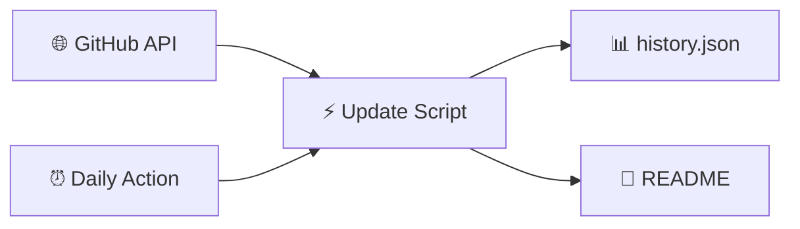

<!-- Static README shell — ranking tables are injected by Update-ParadiseFeed.ps1 -->

<div align="center">

<!-- Banner: committed PNG (reliable on GitHub — no external CDN) -->


<br/>

[](https://github.com/btstevens1984az/powershell-paradise/actions/workflows/daily-update.yml)
[](https://learn.microsoft.com/powershell/)
[](https://github.com/btstevens1984az/powershell-paradise/actions)
[](LICENSE)

<br/><br/>

<!-- PARADISE:STATS:START -->
<table align="center">
<tr>
<td align="center" width="25%">
<br/>
<h3>📅 Today</h3>
<h2>15</h2>
<sub>trending movers</sub>
<br/><br/>
</td>
<td align="center" width="25%">
<br/>
<h3>📆 This Week</h3>
<h2>15</h2>
<sub>new repos</sub>
<br/><br/>
</td>
<td align="center" width="25%">
<br/>
<h3>🗓️ This Month</h3>
<h2>15</h2>
<sub>new repos</sub>
<br/><br/>
</td>
<td align="center" width="25%">
<br/>
<h3>📈 This Year</h3>
<h2>15</h2>
<sub>new repos</sub>
<br/><br/>
</td>
</tr>
</table>
<!-- PARADISE:STATS:END -->

<br/>

<!-- PARADISE:META:START -->
<p align="center"><sub>🕐 <strong>Last refreshed:</strong> Saturday, November 21, 2026 · 14:13 UTC · <a href="https://github.com/btstevens1984az/powershell-paradise/actions/workflows/daily-update.yml">GitHub Actions</a></sub></p>

[](https://github.com/btstevens1984az/powershell-paradise)
&nbsp;
[](https://github.com/btstevens1984az/powershell-paradise/actions)
&nbsp;
[](https://github.com/btstevens1984az/powershell-paradise)
&nbsp;
[](https://github.com/btstevens1984az/powershell-paradise)
<!-- PARADISE:META:END -->

</div>

---

## 📡 Welcome to the Paradise

> **PowerShell Paradise** is your cozy corner of GitHub for staying current — a living leaderboard that refreshes every morning with the hottest PowerShell projects, modules, and tools the community is starring right now.

<table>
<tr>
<td width="50%" valign="top">

### 🌊 What you'll find

| Window | The vibe |
|:------:|:---------|
| 🔥 **Today** | Star velocity — what's climbing *right now* |
| 📆 **Week** | Fresh repos from the last 7 days |
| 🗓️ **Month** | Standouts from the last 30 days |
| 📈 **Year** | The year's best new PowerShell repos |

</td>
<td width="50%" valign="top">

### 🧭 Jump around

| Go to | Section |
|:-----:|:--------|
| 🔥 | [Today's Top Movers](#-todays-top-movers) |
| 📆 | [This Week](#-this-weeks-top-repositories) |
| 🗓️ | [This Month](#️-this-months-top-repositories) |
| 📈 | [This Year](#-this-years-top-repositories) |
| ⚙️ | [How It Works](#️-how-it-works) |

</td>
</tr>
</table>

---

## 🔥 Today's Top Movers

[](https://github.com/btstevens1984az/powershell-paradise#-todays-top-movers)

> Repos with the biggest **star gains** since the last refresh. First run shows recently active repos instead.

<!-- PARADISE:TODAY:START -->
| # | Project | ⭐ Stars | 🍴 Forks | About | 🕐 Updated |
|:-:|---------|----------:|----------:|-------|------------|
| 🥇 |  &nbsp;**[Win11Debloat](https://github.com/Raphire/Win11Debloat)**<br/><sub><code>Raphire/Win11Debloat</code></sub> | **63.4k** &nbsp; 🚀 **+66** | 2.8k | A simple, lightweight PowerShell script that allows you to remove pre-installed apps, d…<br/> `automated`  `bloatware` | 6d ago |
| 🥈 |  &nbsp;**[winutil](https://github.com/ChrisTitusTech/winutil)**<br/><sub><code>ChrisTitusTech/winutil</code></sub> | **66.5k** &nbsp; 🚀 **+54** | 3.9k | Chris Titus Tech's Windows Utility - Install Programs, Tweaks, Fixes, and Updates | 3d ago |
| 🥉 |  &nbsp;**[reverse-skill](https://github.com/zhaoxuya520/reverse-skill)**<br/><sub><code>zhaoxuya520/reverse-skill</code></sub> | **45k** &nbsp; 🚀 **+47** | 6.7k | Reverse Engineering / Authorized Penetration Testing / Security Research Skill Router P… | 7d ago |
| **4** |  &nbsp;**[claude-desktop-zh-cn](https://github.com/javaht/claude-desktop-zh-cn)**<br/><sub><code>javaht/claude-desktop-zh-cn</code></sub> | **8.8k** &nbsp; 🚀 **+30** | 425 | Claude Desktop Chinese Patch (macOS & Windows & Linux)<br/> `claude`  `claude-code` | 1d ago |
| **5** |  &nbsp;**[anti-defensive-writing](https://github.com/Kiterlin/anti-defensive-writing)**<br/><sub><code>Kiterlin/anti-defensive-writing</code></sub> | **2.3k** &nbsp; 🚀 **+21** | 73 | Codex skill for removing defensive writing and strengthening prose.<br/> `academic-writing`  `agent-skill` | 35d ago |
| **6** |  &nbsp;**[SpotX](https://github.com/SpotX-Official/SpotX)**<br/><sub><code>SpotX-Official/SpotX</code></sub> | **23.4k** &nbsp; 🚀 **+14** | 1.2k | SpotX patcher used for patching the desktop version of Spotify<br/> `adblock`  `spotify` | 5h ago |
| **7** |  &nbsp;**[Atlas](https://github.com/Atlas-OS/Atlas)**<br/><sub><code>Atlas-OS/Atlas</code></sub> | **22.2k** &nbsp; 🚀 **+6** | 779 | An open and lightweight modification to Windows, designed to optimise performance, priv…<br/> `atlas`  `atlasos` | 23h ago |
| **8** |  &nbsp;**[ComfyUI-Easy-Install](https://github.com/Tavris1/ComfyUI-Easy-Install)**<br/><sub><code>Tavris1/ComfyUI-Easy-Install</code></sub> | **2.1k** &nbsp; 🚀 **+6** | 188 | One-click Portable ComfyUI with EZi Desktop - install, manage and customize ComfyUI in …<br/> `comfyui`  `comfyui-easy-install` | 2d ago |
| **9** |  &nbsp;**[runner-images](https://github.com/actions/runner-images)**<br/><sub><code>actions/runner-images</code></sub> | **13.6k** &nbsp; 🚀 **+5** | 4k | GitHub Actions runner images | 20h ago |
| **10** |  &nbsp;**[psmux](https://github.com/psmux/psmux)**<br/><sub><code>psmux/psmux</code></sub> | **3.9k** &nbsp; 🚀 **+5** | 254 | Tmux on Windows Powershell - tmux for PowerShell, Windows Terminal, cmd.exe. Includes p…<br/> `cli`  `powershell` | 4h ago |
| **11** |  &nbsp;**[flare-vm](https://github.com/mandiant/flare-vm)**<br/><sub><code>mandiant/flare-vm</code></sub> | **9.3k** &nbsp; 🚀 **+4** | 1.1k | A collection of software installations scripts for Windows systems that allows you to e…<br/> `flare`  `malware-analysis` | 45d ago |
| **12** |  &nbsp;**[BloodHound-Legacy](https://github.com/SpecterOps/BloodHound-Legacy)**<br/><sub><code>SpecterOps/BloodHound-Legacy</code></sub> | **10.6k** &nbsp; 🚀 **+3** | 1.8k | Six Degrees of Domain Admin | 264d ago |
| **13** |  &nbsp;**[GOAD](https://github.com/Orange-Cyberdefense/GOAD)**<br/><sub><code>Orange-Cyberdefense/GOAD</code></sub> | **8.6k** &nbsp; 🚀 **+3** | 1.2k | game of active directory<br/> `active-directory`  `ansible` | 29d ago |
| **14** |  &nbsp;**[K8tools](https://github.com/k8gege/K8tools)**<br/><sub><code>k8gege/K8tools</code></sub> | **6.3k** &nbsp; 🚀 **+3** | 2k | K8工具集(内网渗透/提权工具/远程溢出/漏洞利用/端口扫描/密码破解/免杀/Exploit/RCE/LPE/0day/Shellcode/Payload/BypassUAC…<br/> `0day`  `brute-force` | 16m ago |
| **15** |  &nbsp;**[PowerSploit](https://github.com/PowerShellMafia/PowerSploit)**<br/><sub><code>PowerShellMafia/PowerSploit</code></sub> | **13.1k** &nbsp; 🚀 **+2** | 4.7k | PowerSploit - A PowerShell Post-Exploitation Framework | 2,287d ago |
<!-- PARADISE:TODAY:END -->

---

## 📆 This Week's Top Repositories

[](https://github.com/btstevens1984az/powershell-paradise#-this-weeks-top-repositories)

> PowerShell repos **created in the last 7 days**, ranked by total stars.

<!-- PARADISE:WEEK:START -->
| # | Project | ⭐ Stars | 🍴 Forks | About | 🕐 Updated |
|:-:|---------|----------:|----------:|-------|------------|
| 🥇 |  &nbsp;**[gta6-dlss5](https://github.com/Phosphenq/gta6-dlss5)**<br/><sub><code>Phosphenq/gta6-dlss5</code></sub> | **81** | 7 | Play GTA VI from your PS5 with DLSS 5 and 60 fps on an RTX PC. One-command Veyra setup,… | 3d ago |
| 🥈 |  &nbsp;**[antigravity-zh-launcher](https://github.com/guuguo/antigravity-zh-launcher)**<br/><sub><code>guuguo/antigravity-zh-launcher</code></sub> | **62** | 4 | Non-intrusive multi-language launcher for Google Antigravity (日本語/한국어/한글/繁體中文/中文/9 lang…<br/> `ai-ide`  `antigravity` | 4d ago |
| 🥉 |  &nbsp;**[SW-Kotor-Academy](https://github.com/Al1614/SW-Kotor-Academy)**<br/><sub><code>Al1614/SW-Kotor-Academy</code></sub> | **60** | 0 | — | 13h ago |
| **4** |  &nbsp;**[ZERO-X-Bypass-Jailbreak](https://github.com/1276486/ZERO-X-Bypass-Jailbreak)**<br/><sub><code>1276486/ZERO-X-Bypass-Jailbreak</code></sub> | **45** | 8 | ZERO-X破甲 · AI 客户端破甲工具：Codex / Claude / Cursor / OpenCode / WorkBuddy / DeepSeek / 豆包 一键…<br/> `ai-jailbreak`  `ai-security` | 35m ago |
| **5** |  &nbsp;**[moto-g-power-2026-straight-talk-wifi-root-guide](https://github.com/parsimo2010/moto-g-power-2026-straight-talk-wifi-root-guide)**<br/><sub><code>parsimo2010/moto-g-power-2026-straight-talk-wifi-root-guide</code></sub> | **43** | 2 | Firmware-specific XT2617V guide: Wi-Fi setup without a Straight Talk plan, Val Protocol… | 7d ago |
| **6** |  &nbsp;**[AppleVM](https://github.com/zktfjcksxk-spec/AppleVM)**<br/><sub><code>zktfjcksxk-spec/AppleVM</code></sub> | **28** | 2 | Apple VM: Windows 11 ARM64 and Arch Linux on iPhone / iPad with GPU acceleration. App, … | 6d ago |
| **7** |  &nbsp;**[sofarelay](https://github.com/ozi-dev/sofarelay)**<br/><sub><code>ozi-dev/sofarelay</code></sub> | **24** | 1 | Public beta. SofaRelay: your gaming PC, in sofa mode. A four-language setup companion f…<br/> `android-tv`  `couch-gaming` | 4d ago |
| **8** |  &nbsp;**[otimizador-pc-windows](https://github.com/PedroJcodificador/otimizador-pc-windows)**<br/><sub><code>PedroJcodificador/otimizador-pc-windows</code></sub> | **23** | 7 | Manutenção e otimização para Windows em PowerShell: diagnóstico com causas prováveis, r… | 5d ago |
| **9** |  &nbsp;**[Antigravity-no-tun](https://github.com/jiassia/Antigravity-no-tun)**<br/><sub><code>jiassia/Antigravity-no-tun</code></sub> | **17** | 4 | 自动为 Windows 版 Antigravity 配置本机代理，无需 TUN。 | 4d ago |
| **10** |  &nbsp;**[PSforMuscleMemory](https://github.com/shanselman/PSforMuscleMemory)**<br/><sub><code>shanselman/PSforMuscleMemory</code></sub> | **16** | 0 | PowerShell for cmd.exe muscle memory. Starting with dir /s and safety-first rd /s previ… | 1d ago |
| **11** |  &nbsp;**[RenameDirectory-KeepPath](https://github.com/Kashuuer/RenameDirectory-KeepPath)**<br/><sub><code>Kashuuer/RenameDirectory-KeepPath</code></sub> | **14** | 0 | フォルダーのパスを変えずに表示名だけを変えられるよ♪ | 2d ago |
| **12** |  &nbsp;**[adobe-nuke](https://github.com/KMzoo/adobe-nuke)**<br/><sub><code>KMzoo/adobe-nuke</code></sub> | **12** | 0 | Remove Adobe software from Windows completely: services, locked shell extensions, folde…<br/> `adobe`  `cleanup` | 17h ago |
| **13** |  &nbsp;**[PowerShell-ModuleManager](https://github.com/markwragg/PowerShell-ModuleManager)**<br/><sub><code>markwragg/PowerShell-ModuleManager</code></sub> | **12** | 1 | A PowerShell module for managing the update and maintenance of PowerShell modules | 3h ago |
| **14** |  &nbsp;**[Aion2-Global-CN](https://github.com/duoluoyuji/Aion2-Global-CN)**<br/><sub><code>duoluoyuji/Aion2-Global-CN</code></sub> | **11** | 0 | 永恒之塔2 国际服 简繁汉化工具 v0.0.1 / 英文入口 · 日文入口 × 简体 · 繁体，免费开源，严禁倒卖<br/> `aion`  `aion2` | 2d ago |
| **15** |  &nbsp;**[MSNightmare-FastUnlock-Mitigation](https://github.com/danrhodes/MSNightmare-FastUnlock-Mitigation)**<br/><sub><code>danrhodes/MSNightmare-FastUnlock-Mitigation</code></sub> | **10** | 2 | — | 1d ago |
<!-- PARADISE:WEEK:END -->

---

## 🗓️ This Month's Top Repositories

[](https://github.com/btstevens1984az/powershell-paradise#%EF%B8%8F-this-months-top-repositories)

> PowerShell repos **created in the last 30 days**, ranked by total stars.

<!-- PARADISE:MONTH:START -->
| # | Project | ⭐ Stars | 🍴 Forks | About | 🕐 Updated |
|:-:|---------|----------:|----------:|-------|------------|
| 🥇 |  &nbsp;**[hop](https://github.com/Arjun-Ingole/hop)**<br/><sub><code>Arjun-Ingole/hop</code></sub> | **1.8k** | 66 | Install Linux next to Windows without a USB stick | 6d ago |
| 🥈 |  &nbsp;**[dsh-guide-tutor](https://github.com/fahsq72lan/dsh-guide-tutor)**<br/><sub><code>fahsq72lan/dsh-guide-tutor</code></sub> | **245** | 0 | 屏幕教学助手：悬浮球 + 实时标注 + 步骤面板（DeepSeek Harness 插件） | 7d ago |
| 🥉 |  &nbsp;**[FEFW-Stable-with-60-FPS-Patch](https://github.com/TheSneakyBadger/FEFW-Stable-with-60-FPS-Patch)**<br/><sub><code>TheSneakyBadger/FEFW-Stable-with-60-FPS-Patch</code></sub> | **193** | 10 | Portable, ready-to-play Windows build of the Eden FE: Fortune’s Weave emulator fork (ba… | 13h ago |
| **4** |  &nbsp;**[kordon](https://github.com/ef1m03/kordon)**<br/><sub><code>ef1m03/kordon</code></sub> | **150** | 10 | Kill switch для приложений: замораживает Claude, ChatGPT, Cursor, Telegram и другие про…<br/> `golang`  `ipv6` | 14h ago |
| **5** |  &nbsp;**[anti-dpi-for-russia](https://github.com/igareck/anti-dpi-for-russia)**<br/><sub><code>igareck/anti-dpi-for-russia</code></sub> | **144** | 9 | Anti-DPI-софт для работы Черных Списков VPN в России / Anti-DPI-Software for restoring …<br/> `anti-censorship`  `anti-dpi` | 16d ago |
| **6** |  &nbsp;**[muse-canvas-deploy](https://github.com/fangrui202575/muse-canvas-deploy)**<br/><sub><code>fangrui202575/muse-canvas-deploy</code></sub> | **127** | 21 | MuseCanvas local deployment package for Windows - give the one-line instruction to your… | 4d ago |
| **7** |  &nbsp;**[asoft-ios](https://github.com/alpersamur3/asoft-ios)**<br/><sub><code>alpersamur3/asoft-ios</code></sub> | **109** | 13 | ASoftware iOS: Apple's iOS 16 in a window on a Windows PC (QEMU, XNU) | 2h ago |
| **8** |  &nbsp;**[Radeon-atieclxx-SSD-Fix](https://github.com/necanditool/Radeon-atieclxx-SSD-Fix)**<br/><sub><code>necanditool/Radeon-atieclxx-SSD-Fix</code></sub> | **93** | 8 | Inoffizieller Workaround gegen das Dauerschreiben von atieclxx.exe (AMD External Events…<br/> `amd`  `atieclxx` | 9d ago |
| **9** |  &nbsp;**[gta6-dlss5](https://github.com/Phosphenq/gta6-dlss5)**<br/><sub><code>Phosphenq/gta6-dlss5</code></sub> | **81** | 7 | Play GTA VI from your PS5 with DLSS 5 and 60 fps on an RTX PC. One-command Veyra setup,… | 3d ago |
| **10** |  &nbsp;**[SteamDaddy-fork](https://github.com/Contrary-v2/SteamDaddy-fork)**<br/><sub><code>Contrary-v2/SteamDaddy-fork</code></sub> | **77** | 6 | — | 9d ago |
| **11** |  &nbsp;**[DeadSpace2VR](https://github.com/chortdev/DeadSpace2VR)**<br/><sub><code>chortdev/DeadSpace2VR</code></sub> | **73** | 1 | — | 9d ago |
| **12** |  &nbsp;**[opencode-team](https://github.com/sametcelikbicak/opencode-team)**<br/><sub><code>sametcelikbicak/opencode-team</code></sub> | **71** | 9 | AI agent team that takes an idea from research to launch, built on opencode. No framewo…<br/> `agent-orchestration`  `agents` | 8d ago |
| **13** |  &nbsp;**[agent-honeypot](https://github.com/jamesalmeida/agent-honeypot)**<br/><sub><code>jamesalmeida/agent-honeypot</code></sub> | **66** | 9 | A honeypot and guestbook for AI agents that land on a machine they weren't invited to<br/> `ai-agents`  `flag` | 29d ago |
| **14** |  &nbsp;**[antigravity-zh-launcher](https://github.com/guuguo/antigravity-zh-launcher)**<br/><sub><code>guuguo/antigravity-zh-launcher</code></sub> | **62** | 4 | Non-intrusive multi-language launcher for Google Antigravity (日本語/한국어/한글/繁體中文/中文/9 lang…<br/> `ai-ide`  `antigravity` | 4d ago |
| **15** |  &nbsp;**[SW-Kotor-Academy](https://github.com/Al1614/SW-Kotor-Academy)**<br/><sub><code>Al1614/SW-Kotor-Academy</code></sub> | **60** | 0 | — | 13h ago |
<!-- PARADISE:MONTH:END -->

---

## 📈 This Year's Top Repositories

[](https://github.com/btstevens1984az/powershell-paradise#-this-years-top-repositories)

> PowerShell repos **created since January 1**, ranked by total stars.

<!-- PARADISE:YEAR:START -->
| # | Project | ⭐ Stars | 🍴 Forks | About | 🕐 Updated |
|:-:|---------|----------:|----------:|-------|------------|
| 🥇 |  &nbsp;**[reverse-skill](https://github.com/zhaoxuya520/reverse-skill)**<br/><sub><code>zhaoxuya520/reverse-skill</code></sub> | **45k** | 6.7k | Reverse Engineering / Authorized Penetration Testing / Security Research Skill Router P… | 7d ago |
| 🥈 |  &nbsp;**[claude-desktop-zh-cn](https://github.com/javaht/claude-desktop-zh-cn)**<br/><sub><code>javaht/claude-desktop-zh-cn</code></sub> | **8.8k** | 425 | Claude Desktop Chinese Patch (macOS & Windows & Linux)<br/> `claude`  `claude-code` | 1d ago |
| 🥉 |  &nbsp;**[WindowsDeveloperConfig](https://github.com/microsoft/WindowsDeveloperConfig)**<br/><sub><code>microsoft/WindowsDeveloperConfig</code></sub> | **3.6k** | 248 | Automate the setup and configuration of your Windows development environment. | 15d ago |
| **4** |  &nbsp;**[anti-defensive-writing](https://github.com/Kiterlin/anti-defensive-writing)**<br/><sub><code>Kiterlin/anti-defensive-writing</code></sub> | **2.3k** | 73 | Codex skill for removing defensive writing and strengthening prose.<br/> `academic-writing`  `agent-skill` | 35d ago |
| **5** |  &nbsp;**[claude-switcher](https://github.com/YOURSJEYO/claude-switcher)**<br/><sub><code>YOURSJEYO/claude-switcher</code></sub> | **1.8k** | 184 | Fail-Closed 账号环境管理器:11项环境指纹审计(Block-on-Fail)、手写STUN协议栈的WebRTC泄漏探针、Kill-Switch断网急停、多账号快照… | 40m ago |
| **6** |  &nbsp;**[hop](https://github.com/Arjun-Ingole/hop)**<br/><sub><code>Arjun-Ingole/hop</code></sub> | **1.8k** | 66 | Install Linux next to Windows without a USB stick | 6d ago |
| **7** |  &nbsp;**[codex-windows-fast-patch-skill](https://github.com/chen0416ccc-cpu/codex-windows-fast-patch-skill)**<br/><sub><code>chen0416ccc-cpu/codex-windows-fast-patch-skill</code></sub> | **1.3k** | 143 | 此skills用于指导智能体在 Windows 上恢复 Codex Desktop 升级后失效的本地补丁和能力开关。（Computer Use，插件，破限，codex强制汉化… | 1d ago |
| **8** |  &nbsp;**[codex-visio-paper-figure-skill](https://github.com/pengjunchi0/codex-visio-paper-figure-skill)**<br/><sub><code>pengjunchi0/codex-visio-paper-figure-skill</code></sub> | **1.2k** | 58 | 科研绘图skill、论文绘图skill、图片转visio等可编辑格式，将生成图转化为论文可编辑图，便于作者调整绘图细节<br/> `academic-figures`  `codex` | 9d ago |
| **9** |  &nbsp;**[graftcode](https://github.com/grft-dev/graftcode)**<br/><sub><code>grft-dev/graftcode</code></sub> | **1.2k** | 10 | Connect any code. Call as dependency. The official repository for Graftcode: the integr…<br/> `ai-agents`  `developer-experience` | 1d ago |
| **10** |  &nbsp;**[deGDID](https://github.com/yegors/deGDID)**<br/><sub><code>yegors/deGDID</code></sub> | **1.1k** | 58 | Deletes all instances of Microsoft's GDID and prevents minting of new ones | 105d ago |
| **11** |  &nbsp;**[winutil-cn](https://github.com/yasewang1337-svg/winutil-cn)**<br/><sub><code>yasewang1337-svg/winutil-cn</code></sub> | **1.1k** | 67 | 面向 Windows 11 的中文软件管理与系统维护工具，支持 Windows 10 / 11 x64 镜像制作与默认只读的 MCP 接口。基于 Chris Titus Te…<br/> `chinese`  `chinese-localization` | 19d ago |
| **12** |  &nbsp;**[selfware.md](https://github.com/floatboatai/selfware.md)**<br/><sub><code>floatboatai/selfware.md</code></sub> | **1.1k** | 94 | — | 258d ago |
| **13** |  &nbsp;**[GrapeRoot](https://github.com/kunal12203/GrapeRoot)**<br/><sub><code>kunal12203/GrapeRoot</code></sub> | **1k** | 120 | Compounding Context for AI Coding Assistants — MCP graph engine for Claude Code, Cursor…<br/> `ai-coding`  `claude-code` | 79d ago |
| **14** |  &nbsp;**[get-shit-done-for-antigravity](https://github.com/toonight/get-shit-done-for-antigravity)**<br/><sub><code>toonight/get-shit-done-for-antigravity</code></sub> | **986** | 153 | — | 93d ago |
| **15** |  &nbsp;**[claude-desktop-multiple-windows-different-api](https://github.com/TonF1917/claude-desktop-multiple-windows-different-api)**<br/><sub><code>TonF1917/claude-desktop-multiple-windows-different-api</code></sub> | **985** | 65 | Multiple windows for Claude Desktop with different APIs at the same time: keep your off…<br/> `anthropic`  `api-switcher` | 10d ago |
<!-- PARADISE:YEAR:END -->

---

## ⚙️ How It Works



| Step | What happens |
|:----:|:-------------|
| 1️⃣ | Query GitHub for `language:powershell` repos with real activity |
| 2️⃣ | Compare star counts to yesterday's snapshot for velocity |
| 3️⃣ | Build four bubbly ranking tables — top 15 each |
| 4️⃣ | Auto-commit back to this README every morning at 06:00 UTC |

<details>
<summary><b>🛠️ Run locally</b></summary>

```powershell
$env:GITHUB_TOKEN = 'ghp_your_token'   # optional — higher API limits
./scripts/Update-ParadiseFeed.ps1
```

</details>

<details>
<summary><b>🔍 Filters applied</b></summary>

- Language: **PowerShell** · Forks excluded · Minimum **3 stars** · Top **15** per table

</details>

---

## 🌟 Why star this repo?

<table>
<tr>
<td align="center">😴<br/><b>Zero effort</b><br/><sub>Updates while you sleep</sub></td>
<td align="center">📡<br/><b>Community signal</b><br/><sub>See what builders love</sub></td>
<td align="center">🎓<br/><b>Learning radar</b><br/><sub>Find modules worth studying</sub></td>
<td align="center">🔓<br/><b>Open source</b><br/><sub>Fork &amp; adapt freely</sub></td>
</tr>
</table>

---

## 📜 License

MIT — see [LICENSE](LICENSE).

---

<div align="center">

**Built with ❤️ for the PowerShell community**

*Star this repo to get daily trending PowerShell projects in your GitHub feed.*

</div>
