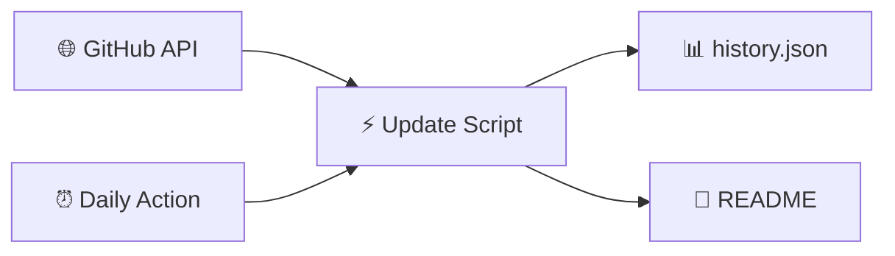

<!-- Static README shell — ranking tables are injected by Update-ParadiseFeed.ps1 -->

<div align="center">

<!-- Banner: committed PNG (reliable on GitHub — no external CDN) -->


<br/>

[](https://github.com/btstevens1984az/powershell-paradise/actions/workflows/daily-update.yml)
[](https://learn.microsoft.com/powershell/)
[](https://github.com/btstevens1984az/powershell-paradise/actions)
[](LICENSE)

<br/><br/>

<!-- PARADISE:STATS:START -->
<table align="center">
<tr>
<td align="center" width="25%">
<br/>
<h3>📅 Today</h3>
<h2>15</h2>
<sub>trending movers</sub>
<br/><br/>
</td>
<td align="center" width="25%">
<br/>
<h3>📆 This Week</h3>
<h2>15</h2>
<sub>new repos</sub>
<br/><br/>
</td>
<td align="center" width="25%">
<br/>
<h3>🗓️ This Month</h3>
<h2>15</h2>
<sub>new repos</sub>
<br/><br/>
</td>
<td align="center" width="25%">
<br/>
<h3>📈 This Year</h3>
<h2>15</h2>
<sub>new repos</sub>
<br/><br/>
</td>
</tr>
</table>
<!-- PARADISE:STATS:END -->

<br/>

<!-- PARADISE:META:START -->
<p align="center"><sub>🕐 <strong>Last refreshed:</strong> Friday, November 27, 2026 · 16:09 UTC · <a href="https://github.com/btstevens1984az/powershell-paradise/actions/workflows/daily-update.yml">GitHub Actions</a></sub></p>

[](https://github.com/btstevens1984az/powershell-paradise)
&nbsp;
[](https://github.com/btstevens1984az/powershell-paradise/actions)
&nbsp;
[](https://github.com/btstevens1984az/powershell-paradise)
&nbsp;
[](https://github.com/btstevens1984az/powershell-paradise)
<!-- PARADISE:META:END -->

</div>

---

## 📡 Welcome to the Paradise

> **PowerShell Paradise** is your cozy corner of GitHub for staying current — a living leaderboard that refreshes every morning with the hottest PowerShell projects, modules, and tools the community is starring right now.

<table>
<tr>
<td width="50%" valign="top">

### 🌊 What you'll find

| Window | The vibe |
|:------:|:---------|
| 🔥 **Today** | Star velocity — what's climbing *right now* |
| 📆 **Week** | Fresh repos from the last 7 days |
| 🗓️ **Month** | Standouts from the last 30 days |
| 📈 **Year** | The year's best new PowerShell repos |

</td>
<td width="50%" valign="top">

### 🧭 Jump around

| Go to | Section |
|:-----:|:--------|
| 🔥 | [Today's Top Movers](#-todays-top-movers) |
| 📆 | [This Week](#-this-weeks-top-repositories) |
| 🗓️ | [This Month](#️-this-months-top-repositories) |
| 📈 | [This Year](#-this-years-top-repositories) |
| ⚙️ | [How It Works](#️-how-it-works) |

</td>
</tr>
</table>

---

## 🔥 Today's Top Movers

[](https://github.com/btstevens1984az/powershell-paradise#-todays-top-movers)

> Repos with the biggest **star gains** since the last refresh. First run shows recently active repos instead.

<!-- PARADISE:TODAY:START -->
| # | Project | ⭐ Stars | 🍴 Forks | About | 🕐 Updated |
|:-:|---------|----------:|----------:|-------|------------|
| 🥇 |  &nbsp;**[winutil](https://github.com/ChrisTitusTech/winutil)**<br/><sub><code>ChrisTitusTech/winutil</code></sub> | **66.8k** &nbsp; 🚀 **+51** | 3.9k | Chris Titus Tech's Windows Utility - Install Programs, Tweaks, Fixes, and Updates | 4d ago |
| 🥈 |  &nbsp;**[Win11Debloat](https://github.com/Raphire/Win11Debloat)**<br/><sub><code>Raphire/Win11Debloat</code></sub> | **63.8k** &nbsp; 🚀 **+41** | 2.9k | A simple, lightweight PowerShell script that allows you to remove pre-installed apps, d…<br/> `automated`  `bloatware` | 12d ago |
| 🥉 |  &nbsp;**[reverse-skill](https://github.com/zhaoxuya520/reverse-skill)**<br/><sub><code>zhaoxuya520/reverse-skill</code></sub> | **45.3k** &nbsp; 🚀 **+39** | 6.8k | Reverse Engineering / Authorized Penetration Testing / Security Research Skill Router P… | 13d ago |
| **4** |  &nbsp;**[Atlas](https://github.com/Atlas-OS/Atlas)**<br/><sub><code>Atlas-OS/Atlas</code></sub> | **22.3k** &nbsp; 🚀 **+29** | 787 | An open and lightweight modification to Windows, designed to optimise performance, priv…<br/> `atlas`  `atlasos` | 5m ago |
| **5** |  &nbsp;**[claude-desktop-zh-cn](https://github.com/javaht/claude-desktop-zh-cn)**<br/><sub><code>javaht/claude-desktop-zh-cn</code></sub> | **8.9k** &nbsp; 🚀 **+24** | 433 | Claude Desktop Chinese Patch (macOS & Windows & Linux)<br/> `claude`  `claude-code` | 1h ago |
| **6** |  &nbsp;**[anti-defensive-writing](https://github.com/Kiterlin/anti-defensive-writing)**<br/><sub><code>Kiterlin/anti-defensive-writing</code></sub> | **2.5k** &nbsp; 🚀 **+22** | 83 | Codex skill for removing defensive writing and strengthening prose.<br/> `academic-writing`  `agent-skill` | 41d ago |
| **7** |  &nbsp;**[SpotX](https://github.com/SpotX-Official/SpotX)**<br/><sub><code>SpotX-Official/SpotX</code></sub> | **23.5k** &nbsp; 🚀 **+16** | 1.2k | SpotX patcher used for patching the desktop version of Spotify<br/> `adblock`  `spotify` | 4d ago |
| **8** |  &nbsp;**[Office-Tool](https://github.com/YerongAI/Office-Tool)**<br/><sub><code>YerongAI/Office-Tool</code></sub> | **14.8k** &nbsp; 🚀 **+6** | 1.1k | Office Tool Plus localization projects.<br/> `msoffice`  `msproject` | 16d ago |
| **9** |  &nbsp;**[GOAD](https://github.com/Orange-Cyberdefense/GOAD)**<br/><sub><code>Orange-Cyberdefense/GOAD</code></sub> | **8.7k** &nbsp; 🚀 **+5** | 1.2k | game of active directory<br/> `active-directory`  `ansible` | 35d ago |
| **10** |  &nbsp;**[Scoop](https://github.com/ScoopInstaller/Scoop)**<br/><sub><code>ScoopInstaller/Scoop</code></sub> | **24.8k** &nbsp; 🚀 **+3** | 1.5k | A command-line installer for Windows.<br/> `installer`  `powershell` | 14h ago |
| **11** |  &nbsp;**[nishang](https://github.com/samratashok/nishang)**<br/><sub><code>samratashok/nishang</code></sub> | **10.2k** &nbsp; 🚀 **+2** | 2.5k | Nishang - Offensive PowerShell for red team, penetration testing and offensive security.<br/> `activedirectory`  `hacking` | 946d ago |
| **12** |  &nbsp;**[flare-vm](https://github.com/mandiant/flare-vm)**<br/><sub><code>mandiant/flare-vm</code></sub> | **9.4k** &nbsp; 🚀 **+2** | 1.1k | A collection of software installations scripts for Windows systems that allows you to e…<br/> `flare`  `malware-analysis` | 51d ago |
| **13** |  &nbsp;**[WindowsDeveloperConfig](https://github.com/microsoft/WindowsDeveloperConfig)**<br/><sub><code>microsoft/WindowsDeveloperConfig</code></sub> | **3.6k** &nbsp; 🚀 **+2** | 249 | Automate the setup and configuration of your Windows development environment. | 3d ago |
| **14** |  &nbsp;**[PowerShell](https://github.com/lazywinadmin/PowerShell)**<br/><sub><code>lazywinadmin/PowerShell</code></sub> | **2.9k** &nbsp; 🚀 **+2** | 744 | PowerShell functions and scripts (Azure, Active Directory, SCCM, SCSM, Exchange, O365, …<br/> `active-directory`  `azure` | 45d ago |
| **15** |  &nbsp;**[ScubaGear](https://github.com/cisagov/ScubaGear)**<br/><sub><code>cisagov/ScubaGear</code></sub> | **2.8k** &nbsp; 🚀 **+2** | 412 | Automation to assess the state of your M365 tenant against CISA's baselines<br/> `assessment-tool`  `cisa` | 14h ago |
<!-- PARADISE:TODAY:END -->

---

## 📆 This Week's Top Repositories

[](https://github.com/btstevens1984az/powershell-paradise#-this-weeks-top-repositories)

> PowerShell repos **created in the last 7 days**, ranked by total stars.

<!-- PARADISE:WEEK:START -->
| # | Project | ⭐ Stars | 🍴 Forks | About | 🕐 Updated |
|:-:|---------|----------:|----------:|-------|------------|
| 🥇 |  &nbsp;**[antigravity-codex-worker](https://github.com/lbc9168/antigravity-codex-worker)**<br/><sub><code>lbc9168/antigravity-codex-worker</code></sub> | **152** | 3 | Antigravity Skill to orchestrate local OpenAI Codex CLI as a sandboxed coding worker wh…<br/> `agent-skills`  `antigravity` | 5d ago |
| 🥈 |  &nbsp;**[win-forge](https://github.com/omerokumus1/win-forge)**<br/><sub><code>omerokumus1/win-forge</code></sub> | **95** | 5 | — | 3d ago |
| 🥉 |  &nbsp;**[HOTD-Scarlet-Dawn-recomp](https://github.com/davidptrssvea/HOTD-Scarlet-Dawn-recomp)**<br/><sub><code>davidptrssvea/HOTD-Scarlet-Dawn-recomp</code></sub> | **33** | 0 | House of The Dead Scarlet Dawn Pc Recomp with lots of graphic settings and full lightgu… | 2d ago |
| **4** |  &nbsp;**[PSforMuscleMemory](https://github.com/shanselman/PSforMuscleMemory)**<br/><sub><code>shanselman/PSforMuscleMemory</code></sub> | **18** | 1 | PowerShell for cmd.exe muscle memory. Starting with dir /s and safety-first rd /s previ… | 5d ago |
| **5** |  &nbsp;**[painel-suporte-ti](https://github.com/davimoraes-tech/painel-suporte-ti)**<br/><sub><code>davimoraes-tech/painel-suporte-ti</code></sub> | **13** | 8 | — | 2d ago |
| **6** |  &nbsp;**[xbox-game-verifier](https://github.com/BoxC4T/xbox-game-verifier)**<br/><sub><code>BoxC4T/xbox-game-verifier</code></sub> | **11** | 0 | verifies the validity of a specific games files | 23h ago |
| **7** |  &nbsp;**[eac-trace-cleaner](https://github.com/meowsilk/eac-trace-cleaner)**<br/><sub><code>meowsilk/eac-trace-cleaner</code></sub> | **9** | 3 | eac/fn cleaner<br/> `cleaner`  `eac` | 4d ago |
| **8** |  &nbsp;**[google-trial-tool](https://github.com/Echiiiro453/google-trial-tool)**<br/><sub><code>Echiiiro453/google-trial-tool</code></sub> | **8** | 3 | — | 20h ago |
| **9** |  &nbsp;**[dsh-web-deploy](https://github.com/linus441/dsh-web-deploy)**<br/><sub><code>linus441/dsh-web-deploy</code></sub> | **8** | 3 | Windows 一键部署：把 DeepSeek Harness 装成独立网页端（与桌面版完全隔离），并自动装好 dsh-purge-plus 破甲插件；带进度提示、一键卸载与…<br/> `deepseek`  `deepseek-harness` | 5d ago |
| **10** |  &nbsp;**[bmw-carplay-hud](https://github.com/huddiedev/bmw-carplay-hud)**<br/><sub><code>huddiedev/bmw-carplay-hud</code></sub> | **8** | 0 | Google Maps arrows from CarPlay on BMW NBT EVO head-up displays - step-by-step Windows …<br/> `bmw`  `carplay` | 6d ago |
| **11** |  &nbsp;**[AGY-CLI-TW](https://github.com/popuchoco/AGY-CLI-TW)**<br/><sub><code>popuchoco/AGY-CLI-TW</code></sub> | **7** | 0 | Google Antigravity CLI 台灣繁體中文增補包：提供 zh-TW 代理規則、狀態列，以及實驗性的 Windows ConPTY TUI 翻譯啟動器。 | 1d ago |
| **12** |  &nbsp;**[windows-hello-ir-only](https://github.com/enese94/windows-hello-ir-only)**<br/><sub><code>enese94/windows-hello-ir-only</code></sub> | **7** | 0 | Restore dark-room Windows Hello facial recognition (IR-only) on Windows 11 without disa…<br/> `cve-2025-26644`  `infrared` | 3d ago |
| **13** |  &nbsp;**[VIctory-Fork-exe](https://github.com/Kumquat7/VIctory-Fork-exe)**<br/><sub><code>Kumquat7/VIctory-Fork-exe</code></sub> | **7** | 0 | Nividia Testing for users | 2h ago |
| **14** |  &nbsp;**[just-volleyball-zh-tw](https://github.com/etetet94/just-volleyball-zh-tw)**<br/><sub><code>etetet94/just-volleyball-zh-tw</code></sub> | **7** | 1 | just volleyball 非官方繁體中文模組：Windows Steam 版，附一鍵安裝、移除工具與完整原始碼。 | 2d ago |
| **15** |  &nbsp;**[ic-antigravity-proxy-cn-launcher](https://github.com/InfiCheesy/ic-antigravity-proxy-cn-launcher)**<br/><sub><code>InfiCheesy/ic-antigravity-proxy-cn-launcher</code></sub> | **6** | 0 | Windows Antigravity custom proxy launcher & auto Chinese localization helper (powered b… | 2d ago |
<!-- PARADISE:WEEK:END -->

---

## 🗓️ This Month's Top Repositories

[](https://github.com/btstevens1984az/powershell-paradise#%EF%B8%8F-this-months-top-repositories)

> PowerShell repos **created in the last 30 days**, ranked by total stars.

<!-- PARADISE:MONTH:START -->
| # | Project | ⭐ Stars | 🍴 Forks | About | 🕐 Updated |
|:-:|---------|----------:|----------:|-------|------------|
| 🥇 |  &nbsp;**[hop](https://github.com/Arjun-Ingole/hop)**<br/><sub><code>Arjun-Ingole/hop</code></sub> | **2k** | 72 | Install Linux next to Windows without a USB stick | 12d ago |
| 🥈 |  &nbsp;**[dsh-guide-tutor](https://github.com/fahsq72lan/dsh-guide-tutor)**<br/><sub><code>fahsq72lan/dsh-guide-tutor</code></sub> | **256** | 0 | 屏幕教学助手：悬浮球 + 实时标注 + 步骤面板（DeepSeek Harness 插件） | 12h ago |
| 🥉 |  &nbsp;**[FEFW-Stable-with-60-FPS-Patch](https://github.com/TheSneakyBadger/FEFW-Stable-with-60-FPS-Patch)**<br/><sub><code>TheSneakyBadger/FEFW-Stable-with-60-FPS-Patch</code></sub> | **204** | 10 | Portable, ready-to-play Windows build of the Eden FE: Fortune’s Weave emulator fork (ba… | 2d ago |
| **4** |  &nbsp;**[kordon](https://github.com/ef1m03/kordon)**<br/><sub><code>ef1m03/kordon</code></sub> | **157** | 12 | Kill switch для приложений: замораживает Claude, ChatGPT, Cursor, Telegram и другие про…<br/> `golang`  `ipv6` | 2d ago |
| **5** |  &nbsp;**[antigravity-codex-worker](https://github.com/lbc9168/antigravity-codex-worker)**<br/><sub><code>lbc9168/antigravity-codex-worker</code></sub> | **152** | 3 | Antigravity Skill to orchestrate local OpenAI Codex CLI as a sandboxed coding worker wh…<br/> `agent-skills`  `antigravity` | 5d ago |
| **6** |  &nbsp;**[antigravity-zh-launcher](https://github.com/guuguo/antigravity-zh-launcher)**<br/><sub><code>guuguo/antigravity-zh-launcher</code></sub> | **146** | 9 | Non-intrusive multi-language launcher for Google Antigravity (日本語/한국어/한글/繁體中文/中文/9 lang…<br/> `ai-ide`  `antigravity` | 2d ago |
| **7** |  &nbsp;**[muse-canvas-deploy](https://github.com/fangrui202575/muse-canvas-deploy)**<br/><sub><code>fangrui202575/muse-canvas-deploy</code></sub> | **140** | 27 | MuseCanvas local deployment package for Windows - give the one-line instruction to your… | 2d ago |
| **8** |  &nbsp;**[ZERO-X-Bypass-Jailbreak](https://github.com/1276486/ZERO-X-Bypass-Jailbreak)**<br/><sub><code>1276486/ZERO-X-Bypass-Jailbreak</code></sub> | **117** | 17 | ZERO-X破甲 · AI 客户端破甲工具：Codex / Claude / Cursor / OpenCode / WorkBuddy / DeepSeek / 豆包 一键…<br/> `ai-jailbreak`  `ai-security` | 14h ago |
| **9** |  &nbsp;**[gta6-dlss5](https://github.com/Phosphenq/gta6-dlss5)**<br/><sub><code>Phosphenq/gta6-dlss5</code></sub> | **97** | 6 | Play GTA VI from your PS5 with DLSS 5 and 60 fps on an RTX PC. One-command Veyra setup,… | 9d ago |
| **10** |  &nbsp;**[win-forge](https://github.com/omerokumus1/win-forge)**<br/><sub><code>omerokumus1/win-forge</code></sub> | **95** | 5 | — | 3d ago |
| **11** |  &nbsp;**[Radeon-atieclxx-SSD-Fix](https://github.com/necanditool/Radeon-atieclxx-SSD-Fix)**<br/><sub><code>necanditool/Radeon-atieclxx-SSD-Fix</code></sub> | **93** | 8 | Inoffizieller Workaround gegen das Dauerschreiben von atieclxx.exe (AMD External Events…<br/> `amd`  `atieclxx` | 15d ago |
| **12** |  &nbsp;**[SW-Kotor-Academy](https://github.com/Al1614/SW-Kotor-Academy)**<br/><sub><code>Al1614/SW-Kotor-Academy</code></sub> | **73** | 1 | — | 6d ago |
| **13** |  &nbsp;**[q-claude-bypass](https://github.com/killedfriend/q-claude-bypass)**<br/><sub><code>killedfriend/q-claude-bypass</code></sub> | **59** | 0 | Educational, non-commercial local gateway for running Claude Code with DeepSeek, Tencen…<br/> `claude-code`  `deepseek` | 7d ago |
| **14** |  &nbsp;**[Antigravity-no-tun](https://github.com/jiassia/Antigravity-no-tun)**<br/><sub><code>jiassia/Antigravity-no-tun</code></sub> | **57** | 7 | 自动为 Windows 版 Antigravity 配置本机代理，无需 TUN。 | 11d ago |
| **15** |  &nbsp;**[antigravity-proxy-fix](https://github.com/xiaobaijiadepugongyingpai-coder/antigravity-proxy-fix)**<br/><sub><code>xiaobaijiadepugongyingpai-coder/antigravity-proxy-fix</code></sub> | **56** | 4 | 让 Google Antigravity 和 agy CLI 在中国大陆网络环境下正常工作 / Fix proxy issues for Antigravity (Elect… | 6d ago |
<!-- PARADISE:MONTH:END -->

---

## 📈 This Year's Top Repositories

[](https://github.com/btstevens1984az/powershell-paradise#-this-years-top-repositories)

> PowerShell repos **created since January 1**, ranked by total stars.

<!-- PARADISE:YEAR:START -->
| # | Project | ⭐ Stars | 🍴 Forks | About | 🕐 Updated |
|:-:|---------|----------:|----------:|-------|------------|
| 🥇 |  &nbsp;**[reverse-skill](https://github.com/zhaoxuya520/reverse-skill)**<br/><sub><code>zhaoxuya520/reverse-skill</code></sub> | **45.3k** | 6.8k | Reverse Engineering / Authorized Penetration Testing / Security Research Skill Router P… | 13d ago |
| 🥈 |  &nbsp;**[claude-desktop-zh-cn](https://github.com/javaht/claude-desktop-zh-cn)**<br/><sub><code>javaht/claude-desktop-zh-cn</code></sub> | **8.9k** | 433 | Claude Desktop Chinese Patch (macOS & Windows & Linux)<br/> `claude`  `claude-code` | 1h ago |
| 🥉 |  &nbsp;**[WindowsDeveloperConfig](https://github.com/microsoft/WindowsDeveloperConfig)**<br/><sub><code>microsoft/WindowsDeveloperConfig</code></sub> | **3.6k** | 249 | Automate the setup and configuration of your Windows development environment. | 3d ago |
| **4** |  &nbsp;**[anti-defensive-writing](https://github.com/Kiterlin/anti-defensive-writing)**<br/><sub><code>Kiterlin/anti-defensive-writing</code></sub> | **2.5k** | 83 | Codex skill for removing defensive writing and strengthening prose.<br/> `academic-writing`  `agent-skill` | 41d ago |
| **5** |  &nbsp;**[hop](https://github.com/Arjun-Ingole/hop)**<br/><sub><code>Arjun-Ingole/hop</code></sub> | **2k** | 72 | Install Linux next to Windows without a USB stick | 12d ago |
| **6** |  &nbsp;**[codex-windows-fast-patch-skill](https://github.com/chen0416ccc-cpu/codex-windows-fast-patch-skill)**<br/><sub><code>chen0416ccc-cpu/codex-windows-fast-patch-skill</code></sub> | **1.4k** | 143 | 此skills用于指导智能体在 Windows 上恢复 Codex Desktop 升级后失效的本地补丁和能力开关。（Computer Use，插件，破限，codex强制汉化… | 7d ago |
| **7** |  &nbsp;**[codex-visio-paper-figure-skill](https://github.com/pengjunchi0/codex-visio-paper-figure-skill)**<br/><sub><code>pengjunchi0/codex-visio-paper-figure-skill</code></sub> | **1.3k** | 58 | 科研绘图skill、论文绘图skill、图片转visio等可编辑格式，将生成图转化为论文可编辑图，便于作者调整绘图细节<br/> `academic-figures`  `codex` | 15d ago |
| **8** |  &nbsp;**[graftcode](https://github.com/grft-dev/graftcode)**<br/><sub><code>grft-dev/graftcode</code></sub> | **1.2k** | 10 | Connect any code. Call as dependency. The official repository for Graftcode: the integr…<br/> `ai-agents`  `developer-experience` | 4d ago |
| **9** |  &nbsp;**[deGDID](https://github.com/yegors/deGDID)**<br/><sub><code>yegors/deGDID</code></sub> | **1.1k** | 57 | Deletes all instances of Microsoft's GDID and prevents minting of new ones | 111d ago |
| **10** |  &nbsp;**[winutil-cn](https://github.com/yasewang1337-svg/winutil-cn)**<br/><sub><code>yasewang1337-svg/winutil-cn</code></sub> | **1.1k** | 67 | 面向 Windows 11 的中文软件管理与系统维护工具，支持 Windows 10 / 11 x64 镜像制作与默认只读的 MCP 接口。基于 Chris Titus Te…<br/> `chinese`  `chinese-localization` | 25d ago |
| **11** |  &nbsp;**[selfware.md](https://github.com/floatboatai/selfware.md)**<br/><sub><code>floatboatai/selfware.md</code></sub> | **1.1k** | 94 | — | 264d ago |
| **12** |  &nbsp;**[GrapeRoot](https://github.com/kunal12203/GrapeRoot)**<br/><sub><code>kunal12203/GrapeRoot</code></sub> | **1.1k** | 120 | Compounding Context for AI Coding Assistants — MCP graph engine for Claude Code, Cursor…<br/> `ai-coding`  `claude-code` | 85d ago |
| **13** |  &nbsp;**[get-shit-done-for-antigravity](https://github.com/toonight/get-shit-done-for-antigravity)**<br/><sub><code>toonight/get-shit-done-for-antigravity</code></sub> | **987** | 153 | — | 99d ago |
| **14** |  &nbsp;**[claude-desktop-multiple-windows-different-api](https://github.com/TonF1917/claude-desktop-multiple-windows-different-api)**<br/><sub><code>TonF1917/claude-desktop-multiple-windows-different-api</code></sub> | **985** | 65 | Multiple windows for Claude Desktop with different APIs at the same time: keep your off…<br/> `anthropic`  `api-switcher` | 16d ago |
| **15** |  &nbsp;**[Light-Help](https://github.com/Cotton059/Light-Help)**<br/><sub><code>Cotton059/Light-Help</code></sub> | **880** | 300 | Help the audience perform some complex operations. | 9d ago |
<!-- PARADISE:YEAR:END -->

---

## ⚙️ How It Works



| Step | What happens |
|:----:|:-------------|
| 1️⃣ | Query GitHub for `language:powershell` repos with real activity |
| 2️⃣ | Compare star counts to yesterday's snapshot for velocity |
| 3️⃣ | Build four bubbly ranking tables — top 15 each |
| 4️⃣ | Auto-commit back to this README every morning at 06:00 UTC |

<details>
<summary><b>🛠️ Run locally</b></summary>

```powershell
$env:GITHUB_TOKEN = 'ghp_your_token'   # optional — higher API limits
./scripts/Update-ParadiseFeed.ps1
```

</details>

<details>
<summary><b>🔍 Filters applied</b></summary>

- Language: **PowerShell** · Forks excluded · Minimum **3 stars** · Top **15** per table

</details>

---

## 🌟 Why star this repo?

<table>
<tr>
<td align="center">😴<br/><b>Zero effort</b><br/><sub>Updates while you sleep</sub></td>
<td align="center">📡<br/><b>Community signal</b><br/><sub>See what builders love</sub></td>
<td align="center">🎓<br/><b>Learning radar</b><br/><sub>Find modules worth studying</sub></td>
<td align="center">🔓<br/><b>Open source</b><br/><sub>Fork &amp; adapt freely</sub></td>
</tr>
</table>

---

## 📜 License

MIT — see [LICENSE](LICENSE).

---

<div align="center">

**Built with ❤️ for the PowerShell community**

*Star this repo to get daily trending PowerShell projects in your GitHub feed.*

</div>
