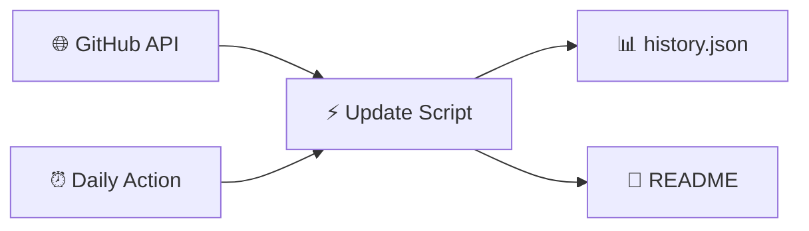

<!-- Static README shell — ranking tables are injected by Update-ParadiseFeed.ps1 -->

<div align="center">

<!-- Banner: committed PNG (reliable on GitHub — no external CDN) -->


<br/>

[](https://github.com/btstevens1984az/powershell-paradise/actions/workflows/daily-update.yml)
[](https://learn.microsoft.com/powershell/)
[](https://github.com/btstevens1984az/powershell-paradise/actions)
[](LICENSE)

<br/><br/>

<!-- PARADISE:STATS:START -->
<table align="center">
<tr>
<td align="center" width="25%">
<br/>
<h3>📅 Today</h3>
<h2>15</h2>
<sub>trending movers</sub>
<br/><br/>
</td>
<td align="center" width="25%">
<br/>
<h3>📆 This Week</h3>
<h2>15</h2>
<sub>new repos</sub>
<br/><br/>
</td>
<td align="center" width="25%">
<br/>
<h3>🗓️ This Month</h3>
<h2>15</h2>
<sub>new repos</sub>
<br/><br/>
</td>
<td align="center" width="25%">
<br/>
<h3>📈 This Year</h3>
<h2>15</h2>
<sub>new repos</sub>
<br/><br/>
</td>
</tr>
</table>
<!-- PARADISE:STATS:END -->

<br/>

<!-- PARADISE:META:START -->
<p align="center"><sub>🕐 <strong>Last refreshed:</strong> Thursday, November 5, 2026 · 13:59 UTC · <a href="https://github.com/btstevens1984az/powershell-paradise/actions/workflows/daily-update.yml">GitHub Actions</a></sub></p>

[](https://github.com/btstevens1984az/powershell-paradise)
&nbsp;
[](https://github.com/btstevens1984az/powershell-paradise/actions)
&nbsp;
[](https://github.com/btstevens1984az/powershell-paradise)
&nbsp;
[](https://github.com/btstevens1984az/powershell-paradise)
<!-- PARADISE:META:END -->

</div>

---

## 📡 Welcome to the Paradise

> **PowerShell Paradise** is your cozy corner of GitHub for staying current — a living leaderboard that refreshes every morning with the hottest PowerShell projects, modules, and tools the community is starring right now.

<table>
<tr>
<td width="50%" valign="top">

### 🌊 What you'll find

| Window | The vibe |
|:------:|:---------|
| 🔥 **Today** | Star velocity — what's climbing *right now* |
| 📆 **Week** | Fresh repos from the last 7 days |
| 🗓️ **Month** | Standouts from the last 30 days |
| 📈 **Year** | The year's best new PowerShell repos |

</td>
<td width="50%" valign="top">

### 🧭 Jump around

| Go to | Section |
|:-----:|:--------|
| 🔥 | [Today's Top Movers](#-todays-top-movers) |
| 📆 | [This Week](#-this-weeks-top-repositories) |
| 🗓️ | [This Month](#️-this-months-top-repositories) |
| 📈 | [This Year](#-this-years-top-repositories) |
| ⚙️ | [How It Works](#️-how-it-works) |

</td>
</tr>
</table>

---

## 🔥 Today's Top Movers

[](https://github.com/btstevens1984az/powershell-paradise#-todays-top-movers)

> Repos with the biggest **star gains** since the last refresh. First run shows recently active repos instead.

<!-- PARADISE:TODAY:START -->
| # | Project | ⭐ Stars | 🍴 Forks | About | 🕐 Updated |
|:-:|---------|----------:|----------:|-------|------------|
| 🥇 |  &nbsp;**[Win11Debloat](https://github.com/Raphire/Win11Debloat)**<br/><sub><code>Raphire/Win11Debloat</code></sub> | **61.7k** &nbsp; 🚀 **+65** | 2.7k | A simple, lightweight PowerShell script that allows you to remove pre-installed apps, d…<br/> `automated`  `bloatware` | 4d ago |
| 🥈 |  &nbsp;**[reverse-skill](https://github.com/zhaoxuya520/reverse-skill)**<br/><sub><code>zhaoxuya520/reverse-skill</code></sub> | **44.2k** &nbsp; 🚀 **+55** | 6.6k | Reverse Engineering / Authorized Penetration Testing / Security Research Skill Router P… | 44d ago |
| 🥉 |  &nbsp;**[winutil](https://github.com/ChrisTitusTech/winutil)**<br/><sub><code>ChrisTitusTech/winutil</code></sub> | **65.6k** &nbsp; 🚀 **+51** | 3.9k | Chris Titus Tech's Windows Utility - Install Programs, Tweaks, Fixes, and Updates | 1d ago |
| **4** |  &nbsp;**[claude-desktop-zh-cn](https://github.com/javaht/claude-desktop-zh-cn)**<br/><sub><code>javaht/claude-desktop-zh-cn</code></sub> | **8.2k** &nbsp; 🚀 **+23** | 397 | Claude Desktop Chinese Patch (macOS & Windows & Linux) | 1d ago |
| **5** |  &nbsp;**[SpotX](https://github.com/SpotX-Official/SpotX)**<br/><sub><code>SpotX-Official/SpotX</code></sub> | **23.2k** &nbsp; 🚀 **+17** | 1.2k | SpotX patcher used for patching the desktop version of Spotify<br/> `adblock`  `spotify` | 4d ago |
| **6** |  &nbsp;**[WindowsDeveloperConfig](https://github.com/microsoft/WindowsDeveloperConfig)**<br/><sub><code>microsoft/WindowsDeveloperConfig</code></sub> | **3.5k** &nbsp; 🚀 **+16** | 243 | Automate the setup and configuration of your Windows development environment. | 2d ago |
| **7** |  &nbsp;**[Atlas](https://github.com/Atlas-OS/Atlas)**<br/><sub><code>Atlas-OS/Atlas</code></sub> | **22k** &nbsp; 🚀 **+14** | 777 | 🚀 An open and lightweight modification to Windows, designed to optimize performance, p…<br/> `ame-wizard`  `atlas` | 2d ago |
| **8** |  &nbsp;**[RemoveWindowsAI](https://github.com/zoicware/RemoveWindowsAI)**<br/><sub><code>zoicware/RemoveWindowsAI</code></sub> | **13.6k** &nbsp; 🚀 **+14** | 477 | Force Remove Copilot, Recall and More in Windows 11<br/> `ai`  `ai-blocker` | 7d ago |
| **9** |  &nbsp;**[flare-vm](https://github.com/mandiant/flare-vm)**<br/><sub><code>mandiant/flare-vm</code></sub> | **9.3k** &nbsp; 🚀 **+6** | 1.1k | A collection of software installations scripts for Windows systems that allows you to e…<br/> `flare`  `malware-analysis` | 29d ago |
| **10** |  &nbsp;**[GOAD](https://github.com/Orange-Cyberdefense/GOAD)**<br/><sub><code>Orange-Cyberdefense/GOAD</code></sub> | **8.6k** &nbsp; 🚀 **+5** | 1.2k | game of active directory<br/> `active-directory`  `ansible` | 13d ago |
| **11** |  &nbsp;**[Flipper-Zero-BadUSB](https://github.com/I-Am-Jakoby/Flipper-Zero-BadUSB)**<br/><sub><code>I-Am-Jakoby/Flipper-Zero-BadUSB</code></sub> | **7.2k** &nbsp; 🚀 **+5** | 892 | Repository for my flipper zero badUSB payloads. Now almost entirely plug and play.<br/> `badusb`  `badusb-payloads` | 873d ago |
| **12** |  &nbsp;**[Office-Tool](https://github.com/YerongAI/Office-Tool)**<br/><sub><code>YerongAI/Office-Tool</code></sub> | **14.7k** &nbsp; 🚀 **+4** | 1.1k | Office Tool Plus localization projects.<br/> `msoffice`  `msproject` | 3h ago |
| **13** |  &nbsp;**[psmux](https://github.com/psmux/psmux)**<br/><sub><code>psmux/psmux</code></sub> | **3.8k** &nbsp; 🚀 **+4** | 245 | Tmux on Windows Powershell - tmux for PowerShell, Windows Terminal, cmd.exe. Includes p…<br/> `cli`  `powershell` | 46m ago |
| **14** |  &nbsp;**[runner-images](https://github.com/actions/runner-images)**<br/><sub><code>actions/runner-images</code></sub> | **13.6k** &nbsp; 🚀 **+3** | 4k | GitHub Actions runner images | 2h ago |
| **15** |  &nbsp;**[posh-git](https://github.com/dahlbyk/posh-git)**<br/><sub><code>dahlbyk/posh-git</code></sub> | **8.3k** &nbsp; 🚀 **+3** | 822 | A PowerShell environment for Git<br/> `chocolatey`  `git` | 794d ago |
<!-- PARADISE:TODAY:END -->

---

## 📆 This Week's Top Repositories

[](https://github.com/btstevens1984az/powershell-paradise#-this-weeks-top-repositories)

> PowerShell repos **created in the last 7 days**, ranked by total stars.

<!-- PARADISE:WEEK:START -->
| # | Project | ⭐ Stars | 🍴 Forks | About | 🕐 Updated |
|:-:|---------|----------:|----------:|-------|------------|
| 🥇 |  &nbsp;**[hop](https://github.com/Arjun-Ingole/hop)**<br/><sub><code>Arjun-Ingole/hop</code></sub> | **1.5k** | 53 | Install Linux next to Windows without a USB stick | 3d ago |
| 🥈 |  &nbsp;**[offline-emergency-library](https://github.com/elhajahmadj/offline-emergency-library)**<br/><sub><code>elhajahmadj/offline-emergency-library</code></sub> | **163** | 16 | One command downloads a complete offline, no-internet emergency library: local AI (CPU/…<br/> `claude`  `claude-code` | 8h ago |
| 🥉 |  &nbsp;**[kordon](https://github.com/ef1m03/kordon)**<br/><sub><code>ef1m03/kordon</code></sub> | **110** | 5 | Kill switch для приложений: замораживает Claude, ChatGPT, Cursor, Telegram и другие про…<br/> `golang`  `ipv6` | 15h ago |
| **4** |  &nbsp;**[pulse-toolkit](https://github.com/lokyfordev/pulse-toolkit)**<br/><sub><code>lokyfordev/pulse-toolkit</code></sub> | **38** | 5 | Published: 2026-10-31<br/> `fps`  `gaming` | 1d ago |
| **5** |  &nbsp;**[nikke_malware](https://github.com/whykusanagi/nikke_malware)**<br/><sub><code>whykusanagi/nikke_malware</code></sub> | **35** | 1 | Free check and removal kit for the InsightJS stealer (k2f) delivered through the NIKKE:…<br/> `crypto-wallet`  `incident-response` | 4h ago |
| **6** |  &nbsp;**[SCSKillerSchineseLanguagePatch](https://github.com/Gkbfst/SCSKillerSchineseLanguagePatch)**<br/><sub><code>Gkbfst/SCSKillerSchineseLanguagePatch</code></sub> | **23** | 0 | # SCSKiller 汉化补丁（非官方）  把 [SCSKiller](https://github.com/BlueHeisenberg/SCSKiller) 的界面文字… | 3h ago |
| **7** |  &nbsp;**[XuperTV-webOS](https://github.com/Not-Yitan/XuperTV-webOS)**<br/><sub><code>Not-Yitan/XuperTV-webOS</code></sub> | **21** | 2 | Xuper TV para LG webOS (no oficial) | 5d ago |
| **8** |  &nbsp;**[bilan-express](https://github.com/sebastienmastain/bilan-express)**<br/><sub><code>sebastienmastain/bilan-express</code></sub> | **18** | 3 | Bilan de santé d'un PC Windows en 2 minutes, avec un rapport client noté sur 100. Scrip…<br/> `audit`  `french` | 3d ago |
| **9** |  &nbsp;**[SQLStatsXRay](https://github.com/mcflyamorim/SQLStatsXRay)**<br/><sub><code>mcflyamorim/SQLStatsXRay</code></sub> | **17** | 0 | — | 2d ago |
| **10** |  &nbsp;**[Enshrouded-Trainer-Windows](https://github.com/GiverExplode/Enshrouded-Trainer-Windows)**<br/><sub><code>GiverExplode/Enshrouded-Trainer-Windows</code></sub> | **16** | 1 | Enshrouded Trainer for Windows — Flameborn expedition planning, Shroud route references…<br/> `base-building`  `crafting-planner` | 6d ago |
| **11** |  &nbsp;**[Rip-It-Card-Collector-Trainer](https://github.com/chambermothexalt/Rip-It-Card-Collector-Trainer)**<br/><sub><code>chambermothexalt/Rip-It-Card-Collector-Trainer</code></sub> | **16** | 1 | Rip It! Card Collector Trainer for Windows — collection-oriented utility layouts with b…<br/> `automation`  `binder-tools` | 6d ago |
| **12** |  &nbsp;**[over-the-hill-Trainer](https://github.com/PlasterWhale/over-the-hill-Trainer)**<br/><sub><code>PlasterWhale/over-the-hill-Trainer</code></sub> | **16** | 0 | over the hill Trainer for Windows with 4x4 expedition layouts, trail-route notes, vehic…<br/> `4x4-simulator`  `driving-tools` | 6d ago |
| **13** |  &nbsp;**[PAO-PAO-Trainer](https://github.com/Cosmicgloexhibit/PAO-PAO-Trainer)**<br/><sub><code>Cosmicgloexhibit/PAO-PAO-Trainer</code></sub> | **16** | 3 | PAO PAO Trainer for Windows — cozy seaside profile concepts with farm planning, kitchen…<br/> `cooking`  `cozy-farming` | 6d ago |
| **14** |  &nbsp;**[CPM-2-Trainer](https://github.com/frequencyclimbersave/CPM-2-Trainer)**<br/><sub><code>frequencyclimbersave/CPM-2-Trainer</code></sub> | **15** | 1 | CPM 2 Trainer for Windows featuring garage setup profiles, drift and race layouts, tuni…<br/> `car-customization`  `car-parking-multiplayer-2` | 6d ago |
| **15** |  &nbsp;**[nikke-k2f-check](https://github.com/WizerdBaChe/nikke-k2f-check)**<br/><sub><code>WizerdBaChe/nikke-k2f-check</code></sub> | **14** | 0 | Self-check and cleanup tool for the 2026 NIKKE PC launcher malware (K2F RAT) on Windows…<br/> `incident-response`  `malware` | 10h ago |
<!-- PARADISE:WEEK:END -->

---

## 🗓️ This Month's Top Repositories

[](https://github.com/btstevens1984az/powershell-paradise#%EF%B8%8F-this-months-top-repositories)

> PowerShell repos **created in the last 30 days**, ranked by total stars.

<!-- PARADISE:MONTH:START -->
| # | Project | ⭐ Stars | 🍴 Forks | About | 🕐 Updated |
|:-:|---------|----------:|----------:|-------|------------|
| 🥇 |  &nbsp;**[hop](https://github.com/Arjun-Ingole/hop)**<br/><sub><code>Arjun-Ingole/hop</code></sub> | **1.5k** | 53 | Install Linux next to Windows without a USB stick | 3d ago |
| 🥈 |  &nbsp;**[GoogleUnlimited](https://github.com/shishir0x/GoogleUnlimited)**<br/><sub><code>shishir0x/GoogleUnlimited</code></sub> | **399** | 58 | Unlimited Google Photos auto-sync on Windows with Pixel original quality spoofing,nativ…<br/> `google-photos`  `unlimited-storage` | 10h ago |
| 🥉 |  &nbsp;**[Antigravity-China-Access](https://github.com/Molly1116/Antigravity-China-Access)**<br/><sub><code>Molly1116/Antigravity-China-Access</code></sub> | **183** | 8 | Google Antigravity 中国大陆网络连接解决方案<br/> `antigravity`  `powershell` | 21d ago |
| **4** |  &nbsp;**[offline-emergency-library](https://github.com/elhajahmadj/offline-emergency-library)**<br/><sub><code>elhajahmadj/offline-emergency-library</code></sub> | **163** | 16 | One command downloads a complete offline, no-internet emergency library: local AI (CPU/…<br/> `claude`  `claude-code` | 8h ago |
| **5** |  &nbsp;**[dsh-rea](https://github.com/Fanqi89/dsh-rea)**<br/><sub><code>Fanqi89/dsh-rea</code></sub> | **129** | 43 | REA (Reverse Engineer Anything) MCP bridge for DeepSeek Harness — 接入 REA 逆向工具的 DSH 插件 | 15d ago |
| **6** |  &nbsp;**[dsh-bilibili-reply](https://github.com/bronyacccxz/dsh-bilibili-reply)**<br/><sub><code>bronyacccxz/dsh-bilibili-reply</code></sub> | **114** | 6 | 让 AI 读懂你在 B 站 @ 它的视频，自动回一条带可跳转时间戳的评论。DSH / AI Agent 技能。<br/> `ai-agents`  `automation` | 16d ago |
| **7** |  &nbsp;**[kordon](https://github.com/ef1m03/kordon)**<br/><sub><code>ef1m03/kordon</code></sub> | **110** | 5 | Kill switch для приложений: замораживает Claude, ChatGPT, Cursor, Telegram и другие про…<br/> `golang`  `ipv6` | 15h ago |
| **8** |  &nbsp;**[clawd-usage-winwidget](https://github.com/Enhed/clawd-usage-winwidget)**<br/><sub><code>Enhed/clawd-usage-winwidget</code></sub> | **86** | 10 | Claude usage limits in a tiny Windows widget + tray icon — with pixel Clawd who reacts …<br/> `anthropic`  `claude` | 2d ago |
| **9** |  &nbsp;**[skate2-recompile-pc](https://github.com/christianortel/skate2-recompile-pc)**<br/><sub><code>christianortel/skate2-recompile-pc</code></sub> | **81** | 1 | Community Windows PC port of Skate 2, built with ReXGlue. Controller support, adjustabl…<br/> `cpp`  `game-preservation` | 24d ago |
| **10** |  &nbsp;**[Hoshimi](https://github.com/Enigfrank/Hoshimi)**<br/><sub><code>Enigfrank/Hoshimi</code></sub> | **79** | 19 | An unofficial game simulation server that enters "companion mode." | 5d ago |
| **11** |  &nbsp;**[artcraft-skills](https://github.com/midasmatterhorn/artcraft-skills)**<br/><sub><code>midasmatterhorn/artcraft-skills</code></sub> | **63** | 5 | Agent skills (SKILL.md) for the ArtCraft Rust creative suite — evidence-verified, MCP/C…<br/> `artcraft`  `cadcraft` | 23h ago |
| **12** |  &nbsp;**[agent-honeypot](https://github.com/jamesalmeida/agent-honeypot)**<br/><sub><code>jamesalmeida/agent-honeypot</code></sub> | **63** | 7 | A honeypot and guestbook for AI agents that land on a machine they weren't invited to<br/> `ai-agents`  `flag` | 13d ago |
| **13** |  &nbsp;**[claude-proxy-guard](https://github.com/Joker-chichi/claude-proxy-guard)**<br/><sub><code>Joker-chichi/claude-proxy-guard</code></sub> | **62** | 8 | Claude Desktop proxy isolation skill for Windows | 13d ago |
| **14** |  &nbsp;**[antigravity-skills](https://github.com/MaDxCRaZY/antigravity-skills)**<br/><sub><code>MaDxCRaZY/antigravity-skills</code></sub> | **60** | 8 | Enterprise-grade extension skills for Google Antigravity: /owl, /battle, /benchmark, an… | 17d ago |
| **15** |  &nbsp;**[php-cve-2026-109618-109619-backports](https://github.com/vperetti/php-cve-2026-109618-109619-backports)**<br/><sub><code>vperetti/php-cve-2026-109618-109619-backports</code></sub> | **60** | 13 | Minimal source backports of the PHP core RCE fixes (CVE-2026-109618 / CVE-2026-109619) … | 14d ago |
<!-- PARADISE:MONTH:END -->

---

## 📈 This Year's Top Repositories

[](https://github.com/btstevens1984az/powershell-paradise#-this-years-top-repositories)

> PowerShell repos **created since January 1**, ranked by total stars.

<!-- PARADISE:YEAR:START -->
| # | Project | ⭐ Stars | 🍴 Forks | About | 🕐 Updated |
|:-:|---------|----------:|----------:|-------|------------|
| 🥇 |  &nbsp;**[reverse-skill](https://github.com/zhaoxuya520/reverse-skill)**<br/><sub><code>zhaoxuya520/reverse-skill</code></sub> | **44.2k** | 6.6k | Reverse Engineering / Authorized Penetration Testing / Security Research Skill Router P… | 44d ago |
| 🥈 |  &nbsp;**[claude-desktop-zh-cn](https://github.com/javaht/claude-desktop-zh-cn)**<br/><sub><code>javaht/claude-desktop-zh-cn</code></sub> | **8.2k** | 397 | Claude Desktop Chinese Patch (macOS & Windows & Linux) | 1d ago |
| 🥉 |  &nbsp;**[WindowsDeveloperConfig](https://github.com/microsoft/WindowsDeveloperConfig)**<br/><sub><code>microsoft/WindowsDeveloperConfig</code></sub> | **3.5k** | 243 | Automate the setup and configuration of your Windows development environment. | 2d ago |
| **4** |  &nbsp;**[anti-defensive-writing](https://github.com/Kiterlin/anti-defensive-writing)**<br/><sub><code>Kiterlin/anti-defensive-writing</code></sub> | **1.7k** | 54 | Codex skill for removing defensive writing and strengthening prose.<br/> `academic-writing`  `agent-skill` | 19d ago |
| **5** |  &nbsp;**[cinema-dna-21x9x3](https://github.com/dacnay816y62-hub/cinema-dna-21x9x3)**<br/><sub><code>dacnay816y62-hub/cinema-dna-21x9x3</code></sub> | **1.5k** | 142 | 高级感电影画面生成 | 47d ago |
| **6** |  &nbsp;**[hop](https://github.com/Arjun-Ingole/hop)**<br/><sub><code>Arjun-Ingole/hop</code></sub> | **1.5k** | 53 | Install Linux next to Windows without a USB stick | 3d ago |
| **7** |  &nbsp;**[codex-windows-fast-patch-skill](https://github.com/chen0416ccc-cpu/codex-windows-fast-patch-skill)**<br/><sub><code>chen0416ccc-cpu/codex-windows-fast-patch-skill</code></sub> | **1.3k** | 141 | 此skills用于指导智能体在 Windows 上恢复 Codex Desktop 升级后失效的本地补丁和能力开关。（Computer Use，插件，破限，codex强制汉化… | 52m ago |
| **8** |  &nbsp;**[codex-visio-paper-figure-skill](https://github.com/pengjunchi0/codex-visio-paper-figure-skill)**<br/><sub><code>pengjunchi0/codex-visio-paper-figure-skill</code></sub> | **1.2k** | 55 | 科研绘图skill、论文绘图skill、图片转visio等可编辑格式，将生成图转化为论文可编辑图，便于作者调整绘图细节<br/> `academic-figures`  `codex` | 81d ago |
| **9** |  &nbsp;**[deGDID](https://github.com/yegors/deGDID)**<br/><sub><code>yegors/deGDID</code></sub> | **1.1k** | 58 | Deletes all instances of Microsoft's GDID and prevents minting of new ones | 89d ago |
| **10** |  &nbsp;**[winutil-cn](https://github.com/yasewang1337-svg/winutil-cn)**<br/><sub><code>yasewang1337-svg/winutil-cn</code></sub> | **1.1k** | 67 | 面向 Windows 11 的中文软件管理与系统维护工具，支持 Windows 10 / 11 x64 镜像制作与默认只读的 MCP 接口。基于 Chris Titus Te…<br/> `chinese`  `chinese-localization` | 3d ago |
| **11** |  &nbsp;**[selfware.md](https://github.com/floatboatai/selfware.md)**<br/><sub><code>floatboatai/selfware.md</code></sub> | **1.1k** | 94 | — | 242d ago |
| **12** |  &nbsp;**[GrapeRoot](https://github.com/kunal12203/GrapeRoot)**<br/><sub><code>kunal12203/GrapeRoot</code></sub> | **1k** | 120 | Compounding Context for AI Coding Assistants — MCP graph engine for Claude Code, Cursor…<br/> `ai-coding`  `claude-code` | 63d ago |
| **13** |  &nbsp;**[graftcode](https://github.com/grft-dev/graftcode)**<br/><sub><code>grft-dev/graftcode</code></sub> | **1k** | 9 | Connect any code. Call as dependency. The official repository for Graftcode: the integr…<br/> `ai-agents`  `developer-experience` | 42d ago |
| **14** |  &nbsp;**[get-shit-done-for-antigravity](https://github.com/toonight/get-shit-done-for-antigravity)**<br/><sub><code>toonight/get-shit-done-for-antigravity</code></sub> | **975** | 152 | — | 77d ago |
| **15** |  &nbsp;**[commands](https://github.com/GuDaStudio/commands)**<br/><sub><code>GuDaStudio/commands</code></sub> | **874** | 49 | — | 272d ago |
<!-- PARADISE:YEAR:END -->

---

## ⚙️ How It Works



| Step | What happens |
|:----:|:-------------|
| 1️⃣ | Query GitHub for `language:powershell` repos with real activity |
| 2️⃣ | Compare star counts to yesterday's snapshot for velocity |
| 3️⃣ | Build four bubbly ranking tables — top 15 each |
| 4️⃣ | Auto-commit back to this README every morning at 06:00 UTC |

<details>
<summary><b>🛠️ Run locally</b></summary>

```powershell
$env:GITHUB_TOKEN = 'ghp_your_token'   # optional — higher API limits
./scripts/Update-ParadiseFeed.ps1
```

</details>

<details>
<summary><b>🔍 Filters applied</b></summary>

- Language: **PowerShell** · Forks excluded · Minimum **3 stars** · Top **15** per table

</details>

---

## 🌟 Why star this repo?

<table>
<tr>
<td align="center">😴<br/><b>Zero effort</b><br/><sub>Updates while you sleep</sub></td>
<td align="center">📡<br/><b>Community signal</b><br/><sub>See what builders love</sub></td>
<td align="center">🎓<br/><b>Learning radar</b><br/><sub>Find modules worth studying</sub></td>
<td align="center">🔓<br/><b>Open source</b><br/><sub>Fork &amp; adapt freely</sub></td>
</tr>
</table>

---

## 📜 License

MIT — see [LICENSE](LICENSE).

---

<div align="center">

**Built with ❤️ for the PowerShell community**

*Star this repo to get daily trending PowerShell projects in your GitHub feed.*

</div>
