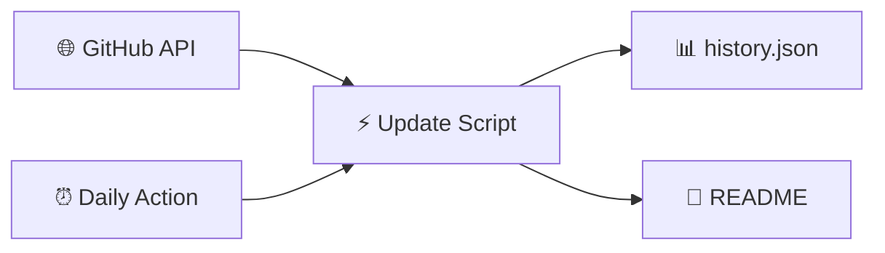

<!-- Static README shell — ranking tables are injected by Update-ParadiseFeed.ps1 -->

<div align="center">

<!-- Banner: committed PNG (reliable on GitHub — no external CDN) -->


<br/>

[](https://github.com/btstevens1984az/powershell-paradise/actions/workflows/daily-update.yml)
[](https://learn.microsoft.com/powershell/)
[](https://github.com/btstevens1984az/powershell-paradise/actions)
[](LICENSE)

<br/><br/>

<!-- PARADISE:STATS:START -->
<table align="center">
<tr>
<td align="center" width="25%">
<br/>
<h3>📅 Today</h3>
<h2>15</h2>
<sub>trending movers</sub>
<br/><br/>
</td>
<td align="center" width="25%">
<br/>
<h3>📆 This Week</h3>
<h2>15</h2>
<sub>new repos</sub>
<br/><br/>
</td>
<td align="center" width="25%">
<br/>
<h3>🗓️ This Month</h3>
<h2>15</h2>
<sub>new repos</sub>
<br/><br/>
</td>
<td align="center" width="25%">
<br/>
<h3>📈 This Year</h3>
<h2>15</h2>
<sub>new repos</sub>
<br/><br/>
</td>
</tr>
</table>
<!-- PARADISE:STATS:END -->

<br/>

<!-- PARADISE:META:START -->
<p align="center"><sub>🕐 <strong>Last refreshed:</strong> Thursday, October 15, 2026 · 10:51 UTC · <a href="https://github.com/btstevens1984az/powershell-paradise/actions/workflows/daily-update.yml">GitHub Actions</a></sub></p>

[](https://github.com/btstevens1984az/powershell-paradise)
&nbsp;
[](https://github.com/btstevens1984az/powershell-paradise/actions)
&nbsp;
[](https://github.com/btstevens1984az/powershell-paradise)
&nbsp;
[](https://github.com/btstevens1984az/powershell-paradise)
<!-- PARADISE:META:END -->

</div>

---

## 📡 Welcome to the Paradise

> **PowerShell Paradise** is your cozy corner of GitHub for staying current — a living leaderboard that refreshes every morning with the hottest PowerShell projects, modules, and tools the community is starring right now.

<table>
<tr>
<td width="50%" valign="top">

### 🌊 What you'll find

| Window | The vibe |
|:------:|:---------|
| 🔥 **Today** | Star velocity — what's climbing *right now* |
| 📆 **Week** | Fresh repos from the last 7 days |
| 🗓️ **Month** | Standouts from the last 30 days |
| 📈 **Year** | The year's best new PowerShell repos |

</td>
<td width="50%" valign="top">

### 🧭 Jump around

| Go to | Section |
|:-----:|:--------|
| 🔥 | [Today's Top Movers](#-todays-top-movers) |
| 📆 | [This Week](#-this-weeks-top-repositories) |
| 🗓️ | [This Month](#️-this-months-top-repositories) |
| 📈 | [This Year](#-this-years-top-repositories) |
| ⚙️ | [How It Works](#️-how-it-works) |

</td>
</tr>
</table>

---

## 🔥 Today's Top Movers

[](https://github.com/btstevens1984az/powershell-paradise#-todays-top-movers)

> Repos with the biggest **star gains** since the last refresh. First run shows recently active repos instead.

<!-- PARADISE:TODAY:START -->
| # | Project | ⭐ Stars | 🍴 Forks | About | 🕐 Updated |
|:-:|---------|----------:|----------:|-------|------------|
| 🥇 |  &nbsp;**[reverse-skill](https://github.com/zhaoxuya520/reverse-skill)**<br/><sub><code>zhaoxuya520/reverse-skill</code></sub> | **42k** &nbsp; 🚀 **+196** | 6.1k | Reverse Engineering / Authorized Penetration Testing / Security Research Skill Router P… | 23d ago |
| 🥈 |  &nbsp;**[winutil](https://github.com/ChrisTitusTech/winutil)**<br/><sub><code>ChrisTitusTech/winutil</code></sub> | **64.2k** &nbsp; 🚀 **+75** | 3.8k | Chris Titus Tech's Windows Utility - Install Programs, Tweaks, Fixes, and Updates | 2d ago |
| 🥉 |  &nbsp;**[Win11Debloat](https://github.com/Raphire/Win11Debloat)**<br/><sub><code>Raphire/Win11Debloat</code></sub> | **59.3k** &nbsp; 🚀 **+73** | 2.6k | A simple, lightweight PowerShell script that allows you to remove pre-installed apps, d…<br/> `automated`  `bloatware` | 1d ago |
| **4** |  &nbsp;**[RemoveWindowsAI](https://github.com/zoicware/RemoveWindowsAI)**<br/><sub><code>zoicware/RemoveWindowsAI</code></sub> | **13.4k** &nbsp; 🚀 **+13** | 469 | Force Remove Copilot, Recall and More in Windows 11<br/> `ai`  `bloatware` | 16h ago |
| **5** |  &nbsp;**[ScubaGear](https://github.com/cisagov/ScubaGear)**<br/><sub><code>cisagov/ScubaGear</code></sub> | **2.7k** &nbsp; 🚀 **+13** | 392 | Automation to assess the state of your M365 tenant against CISA's baselines<br/> `assessment-tool`  `cisa` | 8h ago |
| **6** |  &nbsp;**[SpotX](https://github.com/SpotX-Official/SpotX)**<br/><sub><code>SpotX-Official/SpotX</code></sub> | **22.7k** &nbsp; 🚀 **+11** | 1.1k | SpotX patcher used for patching the desktop version of Spotify<br/> `adblock`  `spotify` | 5d ago |
| **7** |  &nbsp;**[flare-vm](https://github.com/mandiant/flare-vm)**<br/><sub><code>mandiant/flare-vm</code></sub> | **9.1k** &nbsp; 🚀 **+9** | 1.1k | A collection of software installations scripts for Windows systems that allows you to e…<br/> `flare`  `malware-analysis` | 8d ago |
| **8** |  &nbsp;**[GOAD](https://github.com/Orange-Cyberdefense/GOAD)**<br/><sub><code>Orange-Cyberdefense/GOAD</code></sub> | **8.5k** &nbsp; 🚀 **+9** | 1.2k | game of active directory<br/> `active-directory`  `ansible` | 217d ago |
| **9** |  &nbsp;**[WindowsDeveloperConfig](https://github.com/microsoft/WindowsDeveloperConfig)**<br/><sub><code>microsoft/WindowsDeveloperConfig</code></sub> | **3.2k** &nbsp; 🚀 **+8** | 218 | Automate the setup and configuration of your Windows development environment. | 2d ago |
| **10** |  &nbsp;**[Office-Tool](https://github.com/YerongAI/Office-Tool)**<br/><sub><code>YerongAI/Office-Tool</code></sub> | **14.5k** &nbsp; 🚀 **+6** | 1.1k | Office Tool Plus localization projects.<br/> `msoffice`  `msproject` | 24d ago |
| **11** |  &nbsp;**[commando-vm](https://github.com/mandiant/commando-vm)**<br/><sub><code>mandiant/commando-vm</code></sub> | **7.8k** &nbsp; 🚀 **+5** | 1.4k | Complete Mandiant Offensive VM (Commando VM), a fully customizable Windows-based pentes…<br/> `fireeye-flare`  `penetration-testing` | 364d ago |
| **12** |  &nbsp;**[core](https://github.com/dotnet/core)**<br/><sub><code>dotnet/core</code></sub> | **22k** &nbsp; 🚀 **+4** | 4.9k | .NET news, announcements, release notes, and more!<br/> `dotnet`  `dotnet-core` | 2d ago |
| **13** |  &nbsp;**[runner-images](https://github.com/actions/runner-images)**<br/><sub><code>actions/runner-images</code></sub> | **13.5k** &nbsp; 🚀 **+3** | 3.9k | GitHub Actions runner images | 1d ago |
| **14** |  &nbsp;**[sql-server-samples](https://github.com/microsoft/sql-server-samples)**<br/><sub><code>microsoft/sql-server-samples</code></sub> | **11.3k** &nbsp; 🚀 **+3** | 9.1k | Azure Data SQL Samples - Official Microsoft GitHub Repository containing code samples f… | 1d ago |
| **15** |  &nbsp;**[nishang](https://github.com/samratashok/nishang)**<br/><sub><code>samratashok/nishang</code></sub> | **10.2k** &nbsp; 🚀 **+3** | 2.5k | Nishang - Offensive PowerShell for red team, penetration testing and offensive security.<br/> `activedirectory`  `hacking` | 903d ago |
<!-- PARADISE:TODAY:END -->

---

## 📆 This Week's Top Repositories

[](https://github.com/btstevens1984az/powershell-paradise#-this-weeks-top-repositories)

> PowerShell repos **created in the last 7 days**, ranked by total stars.

<!-- PARADISE:WEEK:START -->
| # | Project | ⭐ Stars | 🍴 Forks | About | 🕐 Updated |
|:-:|---------|----------:|----------:|-------|------------|
| 🥇 |  &nbsp;**[skate2-recompile-pc](https://github.com/christianortel/skate2-recompile-pc)**<br/><sub><code>christianortel/skate2-recompile-pc</code></sub> | **40** | 0 | Community Windows PC port of Skate 2, built with ReXGlue. Controller support, adjustabl…<br/> `cpp`  `game-preservation` | 3d ago |
| 🥈 |  &nbsp;**[power-agent](https://github.com/nakasyou/power-agent)**<br/><sub><code>nakasyou/power-agent</code></sub> | **14** | 0 | A minimal harness built entirely in PowerShell<br/> `agent-harness`  `agentic-ai` | 7d ago |
| 🥉 |  &nbsp;**[Hayabusa-Bulk-Runner](https://github.com/rorywag/Hayabusa-Bulk-Runner)**<br/><sub><code>rorywag/Hayabusa-Bulk-Runner</code></sub> | **13** | 0 | Bulk-run Hayabusa across a folder of KAPE collections, one run per host, with per-host …<br/> `dfir`  `digital-forensics` | 37m ago |
| **4** |  &nbsp;**[street-recomp-v3](https://github.com/recomp-code/street-recomp-v3)**<br/><sub><code>recomp-code/street-recomp-v3</code></sub> | **12** | 0 | — | 13h ago |
| **5** |  &nbsp;**[pwshguard](https://github.com/glueckkanja/pwshguard)**<br/><sub><code>glueckkanja/pwshguard</code></sub> | **12** | 3 | Security checks for PowerShell in GitHub Actions, built on PSScriptAnalyzer | 6d ago |
| **6** |  &nbsp;**[CVE-2026-85884](https://github.com/Beardhammer/CVE-2026-85884)**<br/><sub><code>Beardhammer/CVE-2026-85884</code></sub> | **12** | 1 | CVE-85884 POC | 2d ago |
| **7** |  &nbsp;**[windots](https://github.com/rishav12s/windots)**<br/><sub><code>rishav12s/windots</code></sub> | **10** | 0 | Catppuccin Dotfiles for Windows | 22h ago |
| **8** |  &nbsp;**[Dreamcast_BIOS_Parity_Fixed](https://github.com/mathieulh/Dreamcast_BIOS_Parity_Fixed)**<br/><sub><code>mathieulh/Dreamcast_BIOS_Parity_Fixed</code></sub> | **9** | 1 | Fixes the HOLLY parity check of a Dreamcast/NAOMI SH‑4 BIOS ROM | 6d ago |
| **9** |  &nbsp;**[TinyCC-builder](https://github.com/DosX-dev/TinyCC-builder)**<br/><sub><code>DosX-dev/TinyCC-builder</code></sub> | **9** | 0 | Build the latest TinyCC for Windows with one click. Complete portable x64/x86/ARM64 too…<br/> `automated-builds`  `c-compiler` | 3h ago |
| **10** |  &nbsp;**[Antigravity-Jailbreak-v2](https://github.com/rbxscamds-a11y/Antigravity-Jailbreak-v2)**<br/><sub><code>rbxscamds-a11y/Antigravity-Jailbreak-v2</code></sub> | **9** | 1 | Ritmada Antigravity 2.0 · Gemini 3.8 Flash Control Engine & 1-Click Installer | 18h ago |
| **11** |  &nbsp;**[fila-boost](https://github.com/edmer664/fila-boost)**<br/><sub><code>edmer664/fila-boost</code></sub> | **8** | 1 | Free, open-source AI planning tool. Supercharge AI coding agents with Filament v5 best …<br/> `ai-agents`  `claude` | 4d ago |
| **12** |  &nbsp;**[fh2-mods](https://github.com/conner-mcvay/fh2-mods)**<br/><sub><code>conner-mcvay/fh2-mods</code></sub> | **8** | 0 | Monorepo for fh2 mods. | 4h ago |
| **13** |  &nbsp;**[HyperDebloat](https://github.com/KayYesR/HyperDebloat)**<br/><sub><code>KayYesR/HyperDebloat</code></sub> | **7** | 0 | Device-aware HyperOS/MIUI debloater for Xiaomi, Redmi and POCO. Rates each package from…<br/> `adb`  `debloat` | 7h ago |
| **14** |  &nbsp;**[d365fo-database-refresh](https://github.com/balsoft-gmbh/d365fo-database-refresh)**<br/><sub><code>balsoft-gmbh/d365fo-database-refresh</code></sub> | **7** | 2 | Balsoft Data Refresh: prepares a Dynamics 365 Finance and Operations environment after …<br/> `azure-devops`  `business-events` | 3d ago |
| **15** |  &nbsp;**[Youtube-Phenom](https://github.com/DeeeVee/Youtube-Phenom)**<br/><sub><code>DeeeVee/Youtube-Phenom</code></sub> | **7** | 0 | Ad-free YouTube VR for Meta Quest. Patched build of YouTube VR 1.88.10 with pre-rolls, … | 1d ago |
<!-- PARADISE:WEEK:END -->

---

## 🗓️ This Month's Top Repositories

[](https://github.com/btstevens1984az/powershell-paradise#%EF%B8%8F-this-months-top-repositories)

> PowerShell repos **created in the last 30 days**, ranked by total stars.

<!-- PARADISE:MONTH:START -->
| # | Project | ⭐ Stars | 🍴 Forks | About | 🕐 Updated |
|:-:|---------|----------:|----------:|-------|------------|
| 🥇 |  &nbsp;**[unreal-home-wizard](https://github.com/amirmushichge/unreal-home-wizard)**<br/><sub><code>amirmushichge/unreal-home-wizard</code></sub> | **291** | 39 | Turn room and home photographs into reviewable, walkable Unreal Engine projects with Co…<br/> `architecture`  `codex` | 21d ago |
| 🥈 |  &nbsp;**[max-payne-2-vr](https://github.com/evilSheep/max-payne-2-vr)**<br/><sub><code>evilSheep/max-payne-2-vr</code></sub> | **194** | 2 | Free PCVR mod for Max Payne 2 - Tested on Quest 3 and PSVR2 | 5d ago |
| 🥉 |  &nbsp;**[SilentAgentHub](https://github.com/SilentLake-Tech-SkillHub/SilentAgentHub)**<br/><sub><code>SilentLake-Tech-SkillHub/SilentAgentHub</code></sub> | **190** | 0 | 一站式 Coding Agent 插件：从需求、研究、设计、原型到开发、测试、发布的全流程规则、Skills 与 Hooks，助力任何 0-1 的想法 | 4d ago |
| **4** |  &nbsp;**[Table-VideoSOP](https://github.com/duoduoler-ops/Table-VideoSOP)**<br/><sub><code>duoduoler-ops/Table-VideoSOP</code></sub> | **179** | 18 | AI video production SOPs, rules, templates and prompts / AI 视频制作 SOP、规则、模板与提示词 | 18d ago |
| **5** |  &nbsp;**[dragon-codex-boot](https://github.com/yushua0808-cpu/dragon-codex-boot)**<br/><sub><code>yushua0808-cpu/dragon-codex-boot</code></sub> | **131** | 15 | Community Windows startup animation launcher for Codex with live-window handoff and rev…<br/> `codex`  `startup-animation` | 9d ago |
| **6** |  &nbsp;**[toolkit-map](https://github.com/haxsd/toolkit-map)**<br/><sub><code>haxsd/toolkit-map</code></sub> | **111** | 6 | 让 AI 编程助手复用本机工具并按项目要求选对版本；Windows 工具发现、验证与项目规则接入。<br/> `ai-agents`  `claude-code` | 1d ago |
| **7** |  &nbsp;**[Deepseek-Harness-Easy-Setup](https://github.com/vobl1999/Deepseek-Harness-Easy-Setup)**<br/><sub><code>vobl1999/Deepseek-Harness-Easy-Setup</code></sub> | **104** | 0 | — | 25d ago |
| **8** |  &nbsp;**[Aion2-Steam-CN](https://github.com/duoluoyuji/Aion2-Steam-CN)**<br/><sub><code>duoluoyuji/Aion2-Steam-CN</code></sub> | **99** | 8 | AION 2 (Steam Playtest) 简体中文一键汉化补丁与还原工具 | 22h ago |
| **9** |  &nbsp;**[GPT-Niang](https://github.com/T7moris/GPT-Niang)**<br/><sub><code>T7moris/GPT-Niang</code></sub> | **81** | 17 | GPT娘额度挂件：Windows / macOS 白发龙娘桌面挂件，自动识别 Free、Go、Plus、Pro 等套餐，按实际额度窗口显示，支持单行居中、语录、按压反馈、拖动… | 3d ago |
| **10** |  &nbsp;**[SrHollow](https://github.com/ivancabrera02/SrHollow)**<br/><sub><code>ivancabrera02/SrHollow</code></sub> | **80** | 9 | — | 24d ago |
| **11** |  &nbsp;**[dsh-pojia-mode](https://github.com/z91772524-ai/dsh-pojia-mode)**<br/><sub><code>z91772524-ai/dsh-pojia-mode</code></sub> | **80** | 14 | 双击一个文件，给 DeepSeek Harness 加一个「破甲模式」Agent Preset —— 零侵入、零依赖、双击无黑框，不改 DSH 一字节代码，升级不丢。<br/> `agent-preset`  `ai-agent` | 20d ago |
| **12** |  &nbsp;**[VK-1](https://github.com/VKmich16/VK-1)**<br/><sub><code>VKmich16/VK-1</code></sub> | **71** | 9 | DSH 余额桌宠 · Windows(PowerShell) + macOS(Swift) 双平台实现 | 6h ago |
| **13** |  &nbsp;**[everything-search-skill](https://github.com/Mayuqi-crypto/everything-search-skill)**<br/><sub><code>Mayuqi-crypto/everything-search-skill</code></sub> | **70** | 2 | ⚡ Ultra-fast, index-powered local file search skill for AI agents (Cursor, Codex, PI-De…<br/> `agent-skill`  `codex` | 25d ago |
| **14** |  &nbsp;**[aegis-claude](https://github.com/Soulringen/aegis-claude)**<br/><sub><code>Soulringen/aegis-claude</code></sub> | **65** | 0 | Windows reset for local Claude device identifiers. Chats stay. / Сброс локальных иденти… | 11d ago |
| **15** |  &nbsp;**[intunewin-contextprep](https://github.com/imabdk/intunewin-contextprep)**<br/><sub><code>imabdk/intunewin-contextprep</code></sub> | **50** | 3 | Right-click an installer in Windows Explorer to package it as an .intunewin, with the d… | 17d ago |
<!-- PARADISE:MONTH:END -->

---

## 📈 This Year's Top Repositories

[](https://github.com/btstevens1984az/powershell-paradise#-this-years-top-repositories)

> PowerShell repos **created since January 1**, ranked by total stars.

<!-- PARADISE:YEAR:START -->
| # | Project | ⭐ Stars | 🍴 Forks | About | 🕐 Updated |
|:-:|---------|----------:|----------:|-------|------------|
| 🥇 |  &nbsp;**[reverse-skill](https://github.com/zhaoxuya520/reverse-skill)**<br/><sub><code>zhaoxuya520/reverse-skill</code></sub> | **42k** | 6.1k | Reverse Engineering / Authorized Penetration Testing / Security Research Skill Router P… | 23d ago |
| 🥈 |  &nbsp;**[WindowsDeveloperConfig](https://github.com/microsoft/WindowsDeveloperConfig)**<br/><sub><code>microsoft/WindowsDeveloperConfig</code></sub> | **3.2k** | 218 | Automate the setup and configuration of your Windows development environment. | 2d ago |
| 🥉 |  &nbsp;**[cinema-dna-21x9x3](https://github.com/dacnay816y62-hub/cinema-dna-21x9x3)**<br/><sub><code>dacnay816y62-hub/cinema-dna-21x9x3</code></sub> | **1.5k** | 141 | 高级感电影画面生成 | 26d ago |
| **4** |  &nbsp;**[codex-windows-fast-patch-skill](https://github.com/chen0416ccc-cpu/codex-windows-fast-patch-skill)**<br/><sub><code>chen0416ccc-cpu/codex-windows-fast-patch-skill</code></sub> | **1.3k** | 133 | 此skills用于指导智能体在 Windows 上恢复 Codex Desktop 升级后失效的本地补丁和能力开关。（Computer Use，插件，破限，codex强制汉化… | 3d ago |
| **5** |  &nbsp;**[deGDID](https://github.com/yegors/deGDID)**<br/><sub><code>yegors/deGDID</code></sub> | **1.1k** | 56 | Deletes all instances of Microsoft's GDID and prevents minting of new ones | 68d ago |
| **6** |  &nbsp;**[anti-defensive-writing](https://github.com/Kiterlin/anti-defensive-writing)**<br/><sub><code>Kiterlin/anti-defensive-writing</code></sub> | **1.1k** | 40 | Codex skill for removing defensive writing and strengthening prose.<br/> `academic-writing`  `agent-skill` | 14d ago |
| **7** |  &nbsp;**[selfware.md](https://github.com/floatboatai/selfware.md)**<br/><sub><code>floatboatai/selfware.md</code></sub> | **1.1k** | 94 | — | 221d ago |
| **8** |  &nbsp;**[GrapeRoot](https://github.com/kunal12203/GrapeRoot)**<br/><sub><code>kunal12203/GrapeRoot</code></sub> | **1k** | 122 | Compounding Context for AI Coding Assistants — MCP graph engine for Claude Code, Cursor…<br/> `ai-coding`  `claude-code` | 42d ago |
| **9** |  &nbsp;**[codex-visio-paper-figure-skill](https://github.com/pengjunchi0/codex-visio-paper-figure-skill)**<br/><sub><code>pengjunchi0/codex-visio-paper-figure-skill</code></sub> | **1k** | 50 | 科研绘图skill、论文绘图skill、图片转visio等可编辑格式，将生成图转化为论文可编辑图，便于作者调整绘图细节<br/> `academic-figures`  `codex` | 60d ago |
| **10** |  &nbsp;**[get-shit-done-for-antigravity](https://github.com/toonight/get-shit-done-for-antigravity)**<br/><sub><code>toonight/get-shit-done-for-antigravity</code></sub> | **959** | 151 | — | 56d ago |
| **11** |  &nbsp;**[graftcode](https://github.com/grft-dev/graftcode)**<br/><sub><code>grft-dev/graftcode</code></sub> | **928** | 9 | Connect any code. Call as dependency. The official repository for Graftcode: the integr…<br/> `ai-agents`  `developer-experience` | 21d ago |
| **12** |  &nbsp;**[winutil-cn](https://github.com/yasewang1337-svg/winutil-cn)**<br/><sub><code>yasewang1337-svg/winutil-cn</code></sub> | **887** | 59 | 面向 Windows 11 的中文软件管理与系统维护工具，支持 Windows 10 / 11 x64 镜像制作与默认只读的 MCP 接口。基于 Chris Titus Te…<br/> `chinese`  `chinese-localization` | 2d ago |
| **13** |  &nbsp;**[commands](https://github.com/GuDaStudio/commands)**<br/><sub><code>GuDaStudio/commands</code></sub> | **877** | 49 | — | 251d ago |
| **14** |  &nbsp;**[Light-Help](https://github.com/Cotton059/Light-Help)**<br/><sub><code>Cotton059/Light-Help</code></sub> | **718** | 289 | Help the audience perform some complex operations. | 4d ago |
| **15** |  &nbsp;**[ai-business-skills](https://github.com/minhnv0807/ai-business-skills)**<br/><sub><code>minhnv0807/ai-business-skills</code></sub> | **614** | 231 | 138 bilingual AI marketing skills (69 VN + 69 Global) for Claude Code, OpenCode, Codex,…<br/> `agent-skills`  `ai-agents` | 33d ago |
<!-- PARADISE:YEAR:END -->

---

## ⚙️ How It Works



| Step | What happens |
|:----:|:-------------|
| 1️⃣ | Query GitHub for `language:powershell` repos with real activity |
| 2️⃣ | Compare star counts to yesterday's snapshot for velocity |
| 3️⃣ | Build four bubbly ranking tables — top 15 each |
| 4️⃣ | Auto-commit back to this README every morning at 06:00 UTC |

<details>
<summary><b>🛠️ Run locally</b></summary>

```powershell
$env:GITHUB_TOKEN = 'ghp_your_token'   # optional — higher API limits
./scripts/Update-ParadiseFeed.ps1
```

</details>

<details>
<summary><b>🔍 Filters applied</b></summary>

- Language: **PowerShell** · Forks excluded · Minimum **3 stars** · Top **15** per table

</details>

---

## 🌟 Why star this repo?

<table>
<tr>
<td align="center">😴<br/><b>Zero effort</b><br/><sub>Updates while you sleep</sub></td>
<td align="center">📡<br/><b>Community signal</b><br/><sub>See what builders love</sub></td>
<td align="center">🎓<br/><b>Learning radar</b><br/><sub>Find modules worth studying</sub></td>
<td align="center">🔓<br/><b>Open source</b><br/><sub>Fork &amp; adapt freely</sub></td>
</tr>
</table>

---

## 📜 License

MIT — see [LICENSE](LICENSE).

---

<div align="center">

**Built with ❤️ for the PowerShell community**

*Star this repo to get daily trending PowerShell projects in your GitHub feed.*

</div>
